# 科普向｜AI 如何拥有记忆？——一文了解 Agent Memory 的体系与原理（一）

## 前言

关于 Agent 的记忆体系，发现身边不少同学在概念上都有些混乱（包括最初使用李博杰老师的教材学习 Agent 的自己）：

- 日常使用 Agent 时，我们经常接触上下文窗口、上下文压缩等上下文工程技术，各类 Agent 教材也似乎总是试图将 Agent 的经典四种记忆类型略显突兀地塞给我们，因此我们自然而然地会将这些概念与 Agent Memory 联系起来
- 然而业界在讨论 Agent 记忆系统，或当我们阅读相关技术文章时，似乎又更多涉及的是外部记忆系统的存储与检索，此时就会冒出一堆 RAG、外部数据库等让人眼花缭乱的技术词汇，以及 Mem0 等工程产品；这类当然也属于 Agent Memory 的讨论范畴，然而其认知成本却又远远大于前者，因此不由得给 Agent Memory 蒙上了一层熟悉而又陌生的面纱

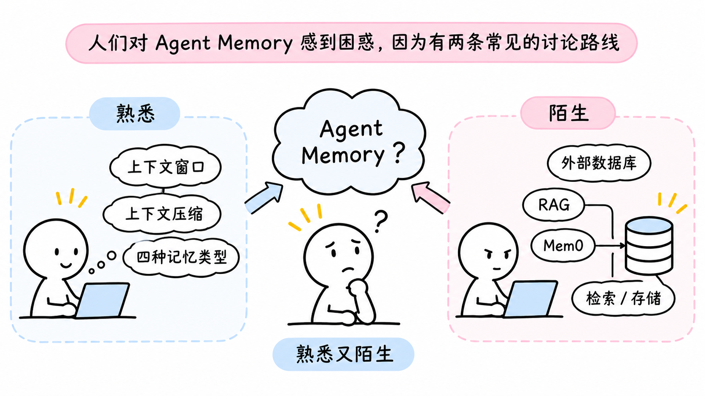

事实上，这两种讨论场景都属于 Agent Memory 的范畴，只不过是从不同的视角出发：

- **认知科学视角**更关注记忆在 Agent 中承担的认知功能，借鉴人类的记忆体系，将 Agent 的记忆划分为不同类型，并探讨这些记忆如何参与当前的推理与决策
- **工程实践视角**则更关注如何实现这些记忆功能，尤其是在有限的上下文窗口下，如何借助外部存储、检索与记忆管理机制，使 Agent 能够有效地保留和利用历史信息

两种视角并不互斥，认知科学视角关注记忆的功能，工程实践视角关注这些功能如何实现；因此，本期将分为两篇文章，分别从认知理论与工程实践的角度展开讨论，由理论到实践逐步梳理 Agent Memory 的体系与原理

## 什么是 Agent Memory？

不管什么时候，进入一个概念或者领域似乎都是从定义开始的，但由于 Agent Memory 的复杂度不在于所见即所得的定义，更多的在于体系的混乱，因此本节侧重点我们放在梳理 Agent Memory 的体系上

### Agent Memory 的思想起源

现在提起 Agent Memory，我们的感觉大抵是约定俗成联系在一起的两个自然词汇；但不妨做一件有意思的事情：试着仔细去凝视这两个词，直至感觉这个概念在我们的意识中慢慢地被解耦（类似于看汉字越看越不像我们认识的汉字的那种感觉），这样做的目的在于尽量不被我们的认知惯性所影响，重新唤起对知识的好奇心，现在我们再来深究一下这个概念的思想起源：

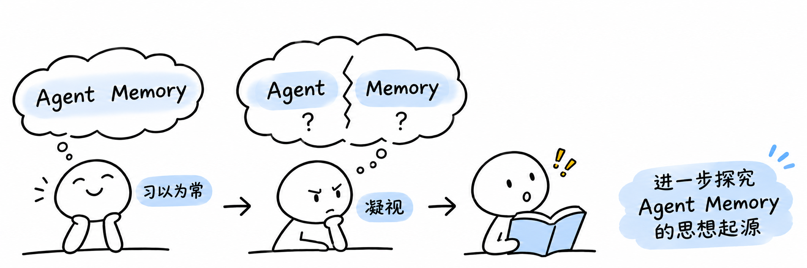

事实上，Memory 这个概念（严谨说是 Memory 的理论体系）并不是一开始就从 LLM 领域诞生的：

- 2023 年 4 月，斯坦福大学与 Google 的研究者发布了 Generative Agents 预印本，提出了记忆流（本质上是只追加的时间戳日志 + 检索 + 定期归纳）。这是早期具有代表性的完整 Agent 记忆架构之一，但此时 Agent Memory 还没有形成一个系统的理论体系。

  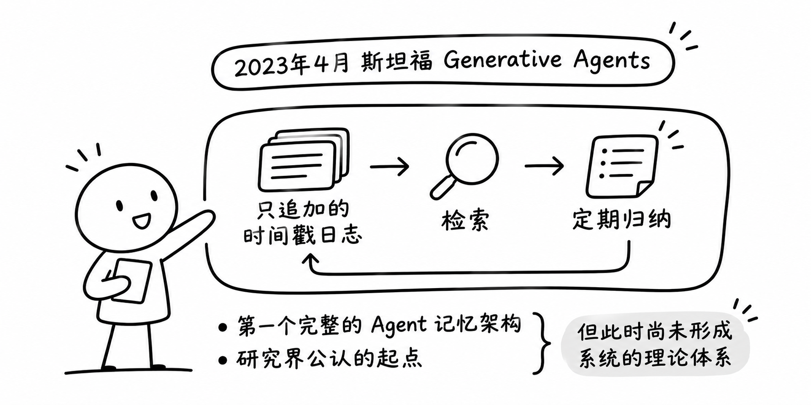

- 2023 年 9 月，CoALA 借鉴了认知心理学以及 Soar 等传统认知架构中的记忆分类思想，将工作记忆、情景记忆、语义记忆和程序性记忆系统化地纳入语言智能体的认知架构中，从此成为了广大 Agent 教材（[深入理解 AI Agent - AI Agents in Depth](https://bojieli.github.io/ai-agent-book/) 等）和理论文章口口相传的理论基石

  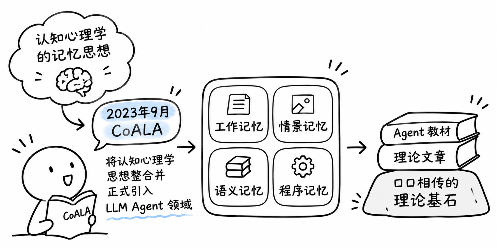

- 但值得一提的是，在另一条路线：**工程实践路线**中，LangChain 在 2022 年底就把 memory 做成了可插拔模块，在工程界形成了“memory 是 Agent 的一个组件”这样的认知并开始传播；次年发表的 MemGPT 则明确借鉴了操作系统的分层内存管理，通过不同记忆层级之间的数据移动，使 LLM 可以使用超出其上下文窗口容量的信息

  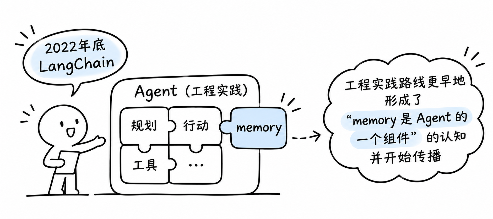

由此可见，Agent 的 Memory 概念在**研究界**，是从认知心理学学科借进 LLM 领域的；顺便一提，上面我们通过凝视概念使之认知解耦的现象也在心理学中有一个学名：叫做语义饱和，说来也饶有趣味：我们正用一个心理学术语，去拆解一个从心理学借来的概念。这也侧面体现了人们意识上的：Agent 与人类心理架构的类比一致性

而在**工程路线**上 Agent memory 的隐喻更多来源于操作系统：Agent 的记忆系统类似于负责给外部存储（硬盘）换页的调度器，这点我们在下文的具体技术也会再次提到

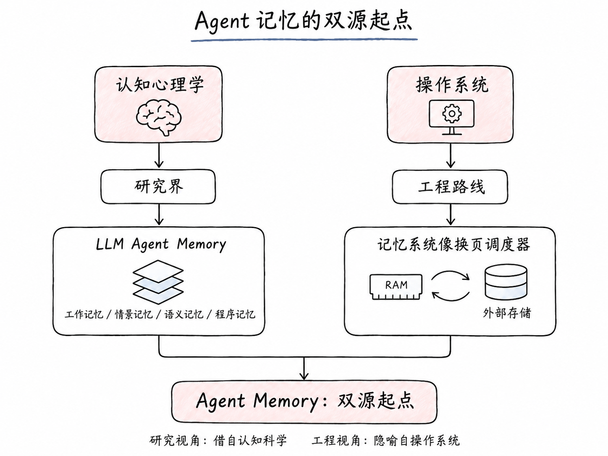

由此我们可以发现：**Agent Memory 的体系似乎从出生起就是双源的，Agent Memory 的设计受到认知科学、传统认知架构和计算机系统等多个领域的启发**

### 与 Agent Memory 相关的概念

关于 Agent Memory 的讨论之所以混乱，除了其体系构成本身复杂，还有很大一部分原因在于：LLM Agent 领域里与 **记忆**这个抽象语义相关的概念实在太多（甚至在一定程度上彼此还存在重合的关系），不完全列举如下：

- **参数记忆（基模权重）**：以神经网络参数的形式内化在模型里的知识，这种记忆在一定程度上相当于模型立身之本的知识库，其更新和修改属于预训练与后训练的研究范畴，而在 Agent Memory 的设计与构建领域无权干涉修改，因此不在本篇记忆系统的讨论范围内
- **认知科学路线的 Agent Memory 分类体系（重要，下文详解）**
- **工程落地中的 Agent Memory 系统实践（在本期第二篇中详解）**
- **上下文 Context（下文详解）：**模型单次推理能看到的全部 token，包含系统提示、对话历史、记忆检索结果和工具返回等
- **外部知识库**：外部知识库作为 Agent 的记忆，主流由**检索增强生成 RAG**引入大众研究视野，然而早期 Agent 记忆常常就是把聊天记录也丢进 RAG 索引，因此 RAG 既可以作为 Agent Memory 并列交叉的技术，也可以只作为 Agent Memory 的一个组件，也因此造成了概念混乱，本期第二篇会简要叙述辨析

对于其中的部分概念，我们不在本篇中过度展开，本期分两篇：主要分别侧重两个方面展开：

1. （一）认知科学路线：解释 Agent Memory 体系的四大记忆分类，它们与上下文的关系，以及典型的狭义上下文工程技术【学习理解 Agent Memory 的重要理论基础】
2. （二）工业实践路线：列举并分析有影响力的记忆架构的核心逻辑【动手构建 Agent Memory 的重要实践基础】

### Agent Memory 系统的定义

最终还是来到了定义解释，虽然 Agent 记忆系统没有一个公认的定义，我们可以从其**定位**和**功能**方面去理解，毕竟一个能让人看得懂的定义才是好定义：

- 记忆系统的诞生动机之一是为了解决以 Transformer 为底层架构的 LLM-Agent 的上下文窗口限制问题
- 记忆系统使 AI Agent 能够像人类一样，在单次对话中保持上下文连贯性（短期记忆），同时能够跨会话记住用户偏好、历史交互和领域知识（长期记忆）

## 认知科学路线的 Agent 记忆分类体系

对于具有显式外部记忆系统的 Agent，我们可以将其一种典型的运行流程概括如下:

1. 接受用户请求
2. **推理前加载（根据用户请求从长期记忆中加载并检索相关信息）**
3. **上下文注入（将长期记忆中检索到的信息加入当前短期记忆，作为上下文辅助 LLM 推理）**
4. **LLM 基于上下文进行推理、决策、执行**
5. **按需更新、遗忘或写入长期记忆**

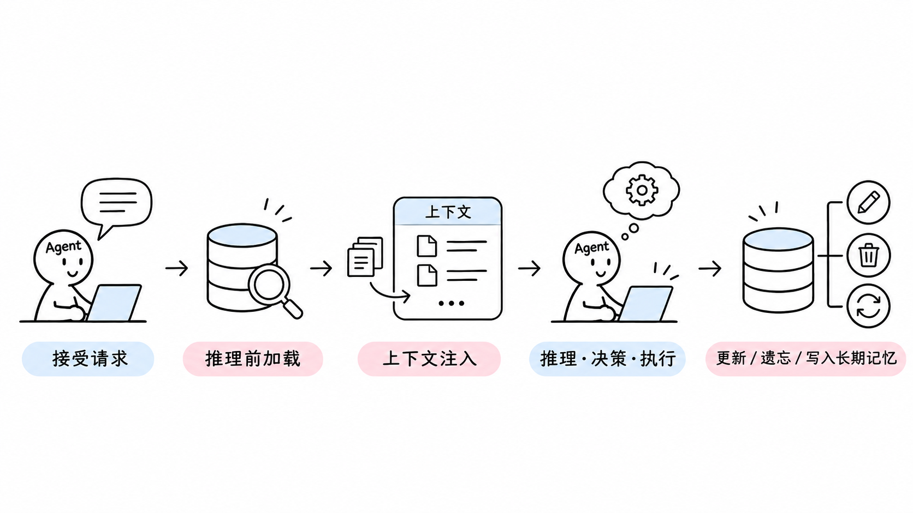

整条逻辑还是很清晰的，接下来我们从认知科学路线中广为流传的 Agent 四类记忆入手，去学习和认识 Agent Memory 的理论基础

### Agent 四类记忆

#### 工作记忆 / 短期记忆 Working Memory

工作记忆属于 Agent 记忆系统里最直白，最简单的一种记忆，旨在保存当前会话的当前任务的活动状态，因而属于“短期记忆”

工作记忆通常是直接存储在对话中的，长期记忆中的信息也会按需被检索并加入到短期工作记忆中，在这种语境下，对应到 LLM Agent，**当前任务的上下文（Context）**就是工作记忆的重要承载方式；但由于上下文受限，Agent 需要对短期会话记忆进行摘要取舍，这就又对应到我们每天都在应对的：上下文压缩

> 工作记忆属于短期记忆，下面的三种都属于长期记忆

#### 情景记忆 Episodic Memory

**Episodic：情景；**在英语原境中有释义为：made up of separate especially loosely connected episodes，即由独立的，特别是松散连接的章节组成的

因此情景记忆我们可以理解为是 Agent 对于过去具体经历、事件和结果信息的记忆；当 Agent 遇到与过去经历类似的问题时，可以检索过去的经历作为参考

#### 语义记忆 Semantic Memory

语义记忆就是 Agent 保存的事实、概念、规律及认识

读到这里可能有些混淆，情景记忆干的不也同样是保存过去的认识吗，这里我们值得通过一个例子区分一下情景记忆和语义记忆的本质区别：假如某日，用户使用 Agent 解决了一个登录失败的 Bug，Agent 自主排查到问题根源是数据库连接池耗尽，准备将该经验记入记忆：

- **情景记忆**存储的是与“具体情景”相关的记忆，例如：“xx 年 xx 月 xx 日（周三），我处理了一次登录失败，最后发现是数据库连接池耗尽”
- 而语义记忆存储的则是与“语义事实”相关的记忆，在这里便是：“数据库连接池耗尽可能导致登录请求失败”这条提炼出来的经验事实

由此我们可以发现，二者回答应对的侧重点是不同的，假如用户提问：曾经是否出现过因数据库连接池耗尽而引发的登录失败，这种情景类问题适合检索情景记忆回答；而假如用户提问：为什么会登录失败，是什么导致的；这种事实类的问题就适合检索语义记忆回答；同时情景记忆也可以经过归纳形成语义记忆

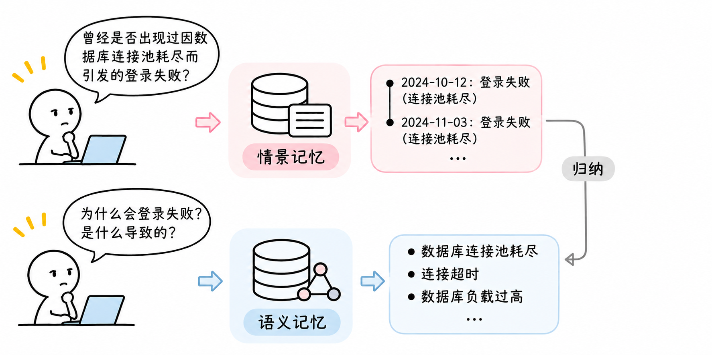

语义记忆通常适合存在于文档、向量索引、关系数据库或知识图谱等外部资源中，用于 Agent 进行事实检索

#### 程序性记忆 Procedural Memory

所谓程序性记忆，就是 Agent 关于如何执行任务的记忆，其擅长捕获工作执行方式，例如工作流等；这里是不是很容易联想到我们每天都在使用的一种技术：skill。没错，skills 作为一种可复用技能也属于程序性记忆

因此在 Agent 的记忆系统中，这类程序性记忆通常都存储为标准化固定的模板、指令等，Agent 一般不会自行**静默**修改

CoALA 讲的程序性记忆，包括隐含在模型权重中的技能，以及写在 Agent 代码里的执行和决策规则。系统提示词、Skill 和 Harness 里描述“怎么做”的部分也可以这样理解，但工具列表本身不等于程序性记忆。

### Agent 四类记忆的关系

了解完四类分类后，最需要我们认知的一点是：这四种记忆是按功能分类的，当然在 Agent 的设计上开发者可以以上述四类记忆为灵感独立进行设计，但并不是说工程上必须有四个独立数据库。它们可以共享存储，也可能互相重叠

同时，CoALA 的四类记忆是一种经典的 Agent 认知功能分类，不是 Agent Memory 唯一的理论体系（有兴趣的佬友可以看一下这篇文章：[[2512.13564] Memory in the Age of AI Agents](https://arxiv.org/abs/2512.13564)，其提出了与传统四类记忆有所不同的现代分类体系）

最终在这条路线下，我们将上文的 Agent Memory 工作流程进一步具体化为这种分类下的特定的工作流程：

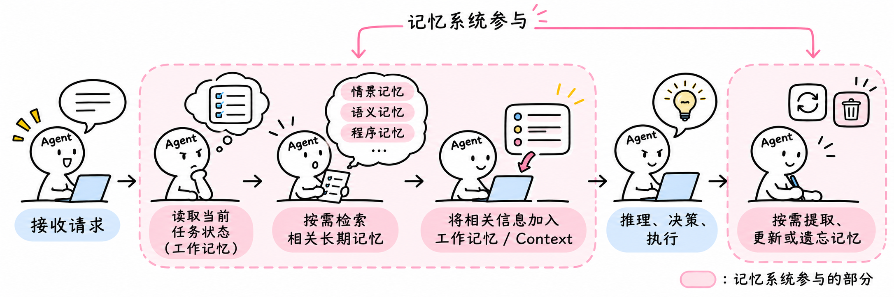

### Agent 记忆与上下文的关系

此外关于上下文，我们日常所说的上下文可以同时包含这四种记忆，以免混淆，我们需要区分一下二者的概念

- 记忆类型：代表某条记忆在 Agent 中承担什么认知功能
- 上下文（context）：代表当前有哪些记忆信息被提供给 Agent 使用（同时还包含当前用户请求、工具定义和新的环境观测等信息）

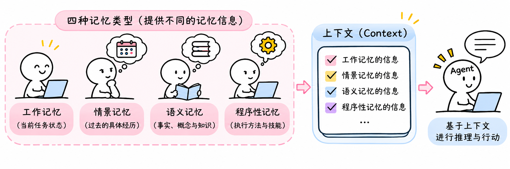

因而，**四种记忆类型与 Context 并不是互斥或者并列的概念**，Context 是当前实际提供给模型的信息集合，可以同时包含工作记忆，以及从情景记忆、语义记忆和程序性记忆中调取的内容。Context Engineering 关注的正是：如何让合适的信息在合适的时机进入模型上下文（参见 [Anthropic 的上下文工程文章](https://www.anthropic.com/research/effective-context-engineering-for-ai-agents)）

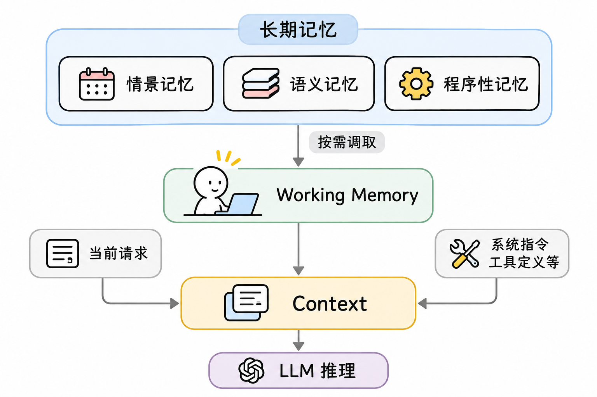

> [!NOTE]
> 我们可以从几个例子来检验一下自己对于四类记忆的了解：
>
> 1. 本轮用户要求：报告里所有金额保留两位小数，不要四舍五入
> 2. 2026 年 3 月 12 日我给这个仓库升级 lodash，构建挂了后，执行回滚才恢复
> 3. 这个仓库升级 lodash 会导致构建失败
> 4. 处理退款要先查订单状态，再核库存，最后走审批流
> 5. 用户对延迟发货特别敏感，提到物流时要先解释原因
> 6. 用户希望我在回答前先说结论

### 上下文工程与典型管理技术

上下文工程在不同的语境下也通常具有不同的含义

狭义的上下文工程（即我们经常所讨论的）指的是解决短期会话记忆中上下文窗口限制和 token 成本问题的各种压缩方法、摘要机制等，其典型管理技术包括：

#### 上下文缩减（Context Reduction）

- **核心思想：**通过直接减少上下文中的信息来缓解窗口限制和 Token 消耗
- **主要方法：**
  - **裁剪：**按规则对上下文中的无用信息进行删除：例如去掉重复 JSON、删除三轮前的工具返回等
  - **总结摘要：**最常见，让 LLM 按照一定策略对上下文进行摘要总结，保留有用的关键信息，重新构建更精简的上下文

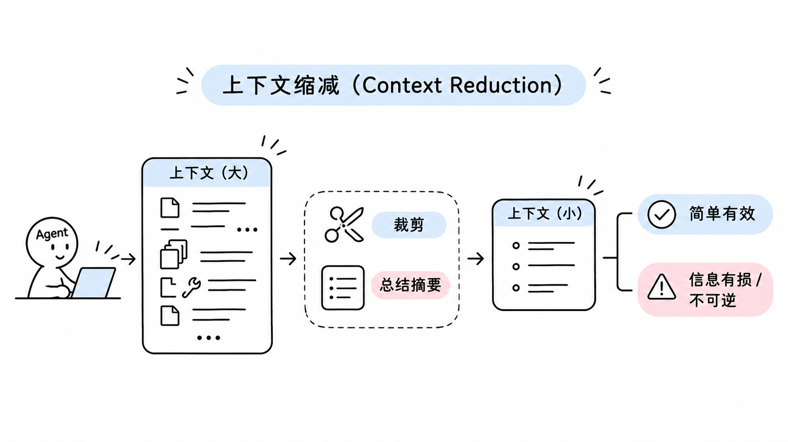

该方法简单有效，但最直接的缺点就是使得信息遗漏且受损（加入外部存储系统可以弥补这一点，因而出现了上下文卸载的实践）

#### 上下文卸载（Context Offloading）

上下文卸载与上下文缩减最直接的不同就是：把原始内容卸载到外部的存储系统，并保留重新访问的能力，而不是不可逆地直接删除

同时，为了原始内容便于检索，上下文中可以保留最小的标识引用，便于直接进行记忆找回

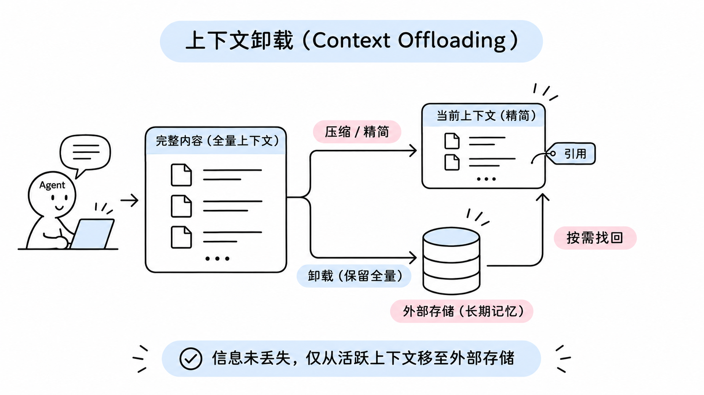

#### 上下文隔离（Context Isolation）

上下文隔离多用于可以调用和支配子 Agent 的多智能体系统：主智能体主要负责任务下发、收取结果与分析决策，不存储中间的无用上下文，子智能体只返回结果，保证主干上下文不被无用信息污染而引发注意力涣散

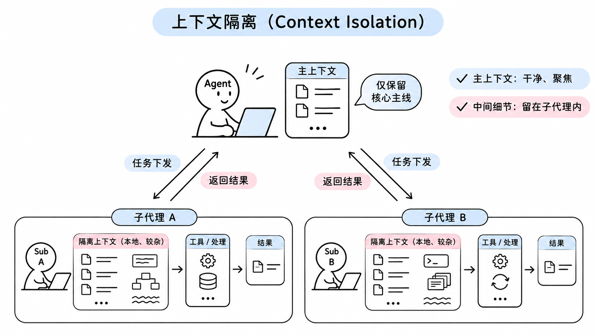

LangChain 官方文章将常见的上下文工程策略归纳为：Write 写入上下文，Select 选择上下文、Compress 压缩上下文、Isolate 隔离上下文

而广义的上下文工程则跳出了在短期记忆中处理的范畴，通常包含更广泛的上下文优化策略，例如模型推理前的：提示词工程、知识库构建、工具集构建工作等，本文不在此处过度展开

---

这篇文章找资料组织内容写了将近两天，第二次写技术科普文有些方面还是不太成熟，如果有问题恳请佬们指正！Agent Memory 的理论基础到这里差不多就铺垫完了，下一篇我们将从工业实践的角度去认识 Agent Memory 系统的组成与有学习价值的典型实践，一起探讨如何设计一个优秀的 Agent Memory

## 参考资料和延伸阅读

### 学术论文

- [Cognitive Architectures for Language Agents（CoALA）](https://arxiv.org/abs/2309.02427) — Sumers et al., 2023
- [Generative Agents: Interactive Simulacra of Human Behavior](https://arxiv.org/abs/2304.03442) — Park et al., 2023
- [MemGPT: Towards LLMs as Operating Systems](https://arxiv.org/abs/2310.08560) — Packer et al., 2023
- [Memory in the Age of AI Agents: A Survey](https://arxiv.org/abs/2512.13564)

### 技术文档与博客

- [LLM Powered Autonomous Agents — Lilian Weng](https://lilianweng.github.io/posts/2023-06-23-agent/)
- [AI Agent 记忆系统：从短期到长期的技术架构与实践](https://mp.weixin.qq.com/s?__biz=MzUzNzYxNjAzMg==&mid=2247581134&idx=1&sn=e8a0360bb1c883122a32da479b4895d7)
- [什么是 Agent 记忆系统？](https://www.thinkingai.cn/blog/what-is-agent-memory-system/)
- [Agentic Memory: How LLM Agents Remember | Levelop](https://levelop.dev/blog/agentic-memory-llm-agents-explained)
- [AI 长期记忆层正在被工程化：从 Letta、Mem0 到 Zep，agent memory stack 的标准正在浮现](https://futurepicker.com/ai-agent-memory-stack-letta-mem0-zep-2026/)
- [Memory Overview — LangChain / LangGraph](https://docs.langchain.com/oss/python/concepts/memory)
- [深入理解 AI Agent — AI Agents in Depth](https://bojieli.github.io/ai-agent-book/)
- [Context Engineering for Agents — LangChain](https://www.langchain.com/blog/context-engineering-for-agents)
- [Context Management for Deep Agents — LangChain](https://www.langchain.com/blog/context-management-for-deepagents)

## 进一步阅读

- 上下文工程实践：
  - [Context Engineering for AI Agents: Lessons from Building Manus](https://manus.im/blog/Context-Engineering-for-AI-Agents-Lessons-from-Building-Manus)
  - [Effective Context Engineering for AI Agents — Anthropic](https://www.anthropic.com/research/effective-context-engineering-for-ai-agents)

## 往期文章

[科普向｜一文了解世界模型（World Model）：通往 AGI 的可行路径？ - 文档共建 - LINUX DO](https://linux.do/t/topic/2816225)

<!-- learning-journey:update-history:start -->
## 更新记录

| 日期 | 类型 | 说明 |
| --- | --- | --- |
| 2026-11-23 | 首次发布 | 从语雀整理并发布到学习记录仓库 |
<!-- learning-journey:update-history:end -->
