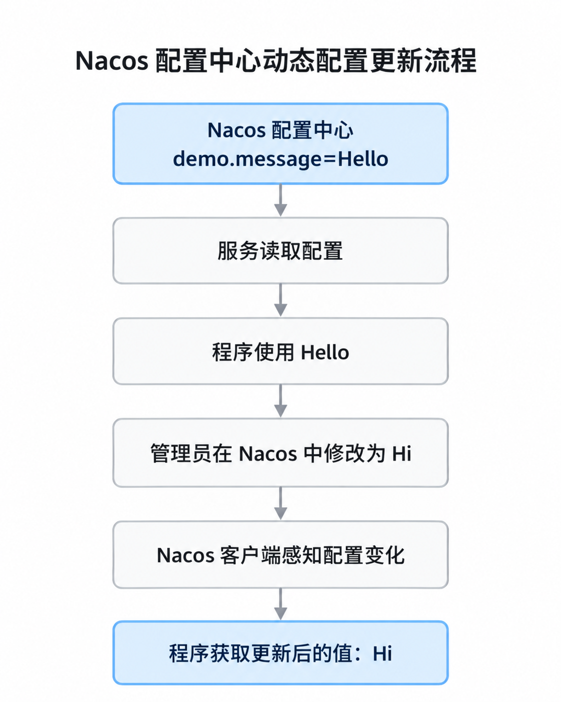
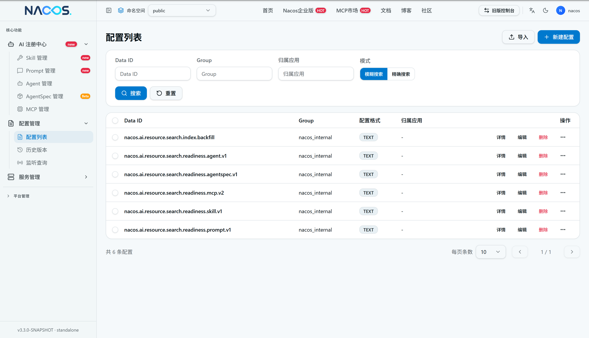
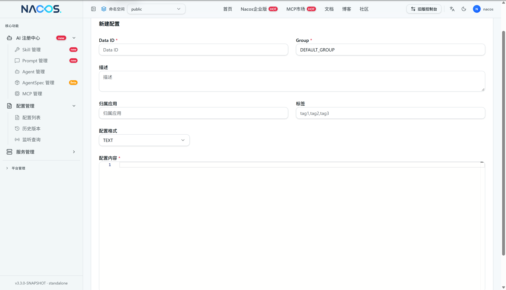

# Week4：服务的提供、调用和资源配置

## 服务调用方的两种调用方式（服务的两种消费方式）
### 服务的提供与消费
+ 服务提供方（Service Provider）：对外提供功能或 API 的服务
+ 服务消费方（Service Consumer）：需要使用其他服务功能、主动发起调用的服务
+ Nacos 注册中心：保存服务及其实例的信息，支持注册与发现

Provider 和 Consumer 是相对角色，一个服务可以同时是提供者和消费者；

Nacos 负责服务注册与发现，不负责代替消费者执行业务 API

### 服务调用（消费）的基本步骤
假设 `consumer-service`想调用 `provider-service`提供的 `/hello`接口

1. 服务发现：查询`provider-service`，找到目标服务有哪些实例
2. 选址：从该服务的可用实例中选一个
3. 寻址：确定该服务的具体请求地址，例如：`http://192.168.1.10:8081/hello`
4. 调用（消费）：发起 HTTP 请求并获取结果，例如 GET 请求并接收返回值

### 第一种方法：原始调用方法【了解】
#### 基本思路：
使用 `LoadBalancerClient + RestTemplate`；

消费者显式编写代码，选择服务实例、获取地址并发送 HTTP 请求；

通过 `LoadBalancerClient` 选出服务实例，再通过 `RestTemplate` 调用该实例的 API

> **远程调用**：一个程序调用另一个程序提供的功能/服务；而不是调用自己程序内部的功能

#### 核心调用逻辑：
```java
// 1. 从 provider-service 的实例中选择一个
ServiceInstance instance =
loadBalancerClient.choose("provider-service");

// 2. 拼接目标 API 的真实地址
String url = instance.getUri() + "/hello";

// 3. 发起 HTTP 请求
String result =
restTemplate.getForObject(url, String.class);
```

#### 优缺点：
+ 优点：过程清楚，容易理解
+ 缺点：远程调用涉及的选址、地址构造及请求代码需要开发者自己处理

### 第二种方式：Feign 声明式调用
#### 基本思路：
使用 `Spring Cloud OpenFeign`

原始调用方式中，消费者需要自己编写代码选择服务实例、获取地址并发送 HTTP 请求，过程比较繁琐

Feign 将这些重复的调用过程封装起来，开发者只需要定义接口，声明要调用哪个服务及其哪个 API，便可以像调用普通 Java 方法一样发起远程调用

#### 核心调用逻辑
假设消费者需要调用 `provider-service`的 `/hello`API

首先定义一个 Feign 接口：

```java
@FeignClient(name = "provider-service")
public interface ProviderClient {

    @GetMapping("/hello")
    String hello();
}
```

其中：

+ `@FeignClient`：声明这是一个远程服务调用接口
+ `name = "provider-service"`：指定要调用的服务名（与 Nacos 中的服务名对应）
+ `@GetMapping("/hello")`：指定目标服务中的 API 路径和请求方式

随后，消费者只需要调用：

```java
String result = providerClient.hello();
```

Feign 就会根据接口声明完成相应的远程 HTTP 调用

#### Feign 实际处理逻辑：
1. 消费者调用 `providerClient.hello()`
2. Feign 确定目标服务 provider-service
3. 借助服务发现获取可用实例
4. 通过 LoadBalancer 选择实例
5. 确定具体 IP、端口和 API 地址
6. 发起 HTTP 请求
7. 返回结果

**Feign 并没有改变远程调用的本质，只是将原本需要开发者手写的调用过程交给框架处理**

## Nacos 处理配置参数（动态）
### 为什么需要配置中心
之前使用 Spring Boot 时，程序的运行参数通常保存在各自的 `application.properties`中，例如：

```properties
matching.top-count=5
matching.relay-enabled=true
```

这些参数用于控制程序的业务行为，如果所有配置都保存在各个项目本地，随着微服务数量增加，会出现两个问题：

1. 配置分散：每个服务都有自己的配置文件，统一维护比较麻烦
2. 修改不方便：部分配置修改后，需要重新部署或重启应用才能生效

因此引入**配置中心（Configuration Center）**，把配置放到统一的位置集中管理，并让应用能够获取和监听配置变化

### Nacos 配置中心
Nacos 两项基本功能：

| 功能 | 核心作用 | 对应组件 |
| --- | --- | --- |
| 服务注册与发现 | 管理服务实例，让服务找到彼此 | Nacos Discovery |
| 配置管理 | 集中保存和分发配置，支持动态更新 | Nacos Config |


服务注册保存的是服务实例信息，配置管理保存的是程序运行需要的配置参数

#### 配置动态更新的基本过程
假设某个服务有一个参数：`demo.message=Hello`；原本这个参数写在项目本地，现在将它交给 Nacos 管理，动态更新流程如下：



程序可以在不重启的情况下使用新的配置值

但服务器监听端口这种启动期配置通常不能靠普通动态刷新直接改变

### Nacos 配置管理的基本概念
Nacos 中的一份配置主要通过以下三个信息定位：

+ Namespace：命名空间，用于隔离不同环境或业务
+ Group：配置分组，未单独指定时通常使用 `DEFAULT_GROUP`
+ Data ID：具体配置文件的标识，例如 `provider-service.properties`

其中 Data ID 用来标识一份配置，而不是某个具体配置参数的名称

### Nacos Config 的基本使用方式
#### 引入依赖
在 `pom.xml`中加入：

```xml
<dependency>
  <groupId>com.alibaba.cloud</groupId>
  <artifactId>spring-cloud-starter-alibaba-nacos-config</artifactId>
</dependency>
```

作用：使 Spring Boot 项目具备从 Nacos 配置中心读取配置的能力

版本由项目中已配置的 Spring Cloud Alibaba 依赖管理统一控制

#### 配置 Nacos 地址及配置来源
在 `application.properties`中加入：

```properties
spring.cloud.nacos.config.server-addr=127.0.0.1:8848

spring.config.import=nacos:provider-service.properties?refreshEnabled=true
```

这两行分别用于：

+ `server-addr`：告诉当前应用 Nacos 配置中心在哪里
+ `spring.config.import`：指定应用要从 Nacos 读取哪份配置
+ `refreshEnabled=true`：启用对该份配置变化的动态监听刷新

#### 在 Nacos 控制台创建配置
进入 Nacos：

`配置管理 → 配置列表 → 创建配置`





#### 在程序中使用配置
例如使用 Spring 的 `@Value`：

```java
@Value("${demo.message}")
private String message;
```

作用：将配置项 `demo.message`的值注入变量 `message`

如果需要让该值在配置更新后动态变化，可以在适当的 Spring Bean 上使用 `@RefreshScope`等刷新机制：

```java
@RestController
@RefreshScope
public class MatchingController {

    @Value("${matching.top-count}")
    private int topCount;

    @GetMapping("/count")
    public int getCount() {
        return topCount;
    }
}
```

+ `@Value`：将 Spring 配置环境中的指定参数值注入 Java 变量
+ `@RefreshScope`：使 Spring Bean 支持动态刷新，在配置变化并触发刷新后，重新创建相关 Bean，从而获取新的配置值

<!-- learning-journey:update-history:start -->
## 更新记录

| 日期 | 类型 | 说明 |
| --- | --- | --- |
| 2026-10-25 | 首次发布 | 从语雀整理并发布到学习记录仓库 |
<!-- learning-journey:update-history:end -->
