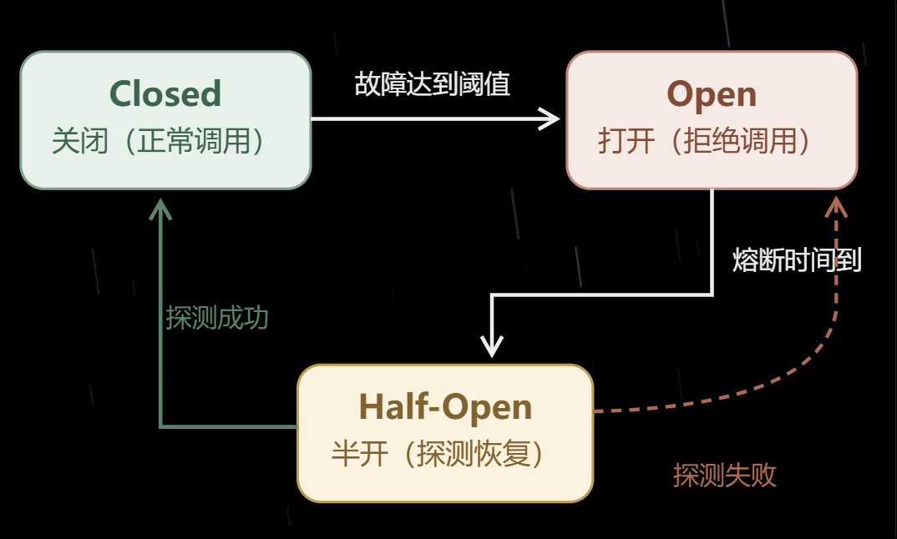

# Week5：服务监控与容灾

## 服务容灾

### 为什么需要服务容灾

微服务架构中，服务之间存在调用依赖关系；一旦出现网络问题，会导致调用该服务出现阻塞

阻塞后如果涌入大量请求而服务来不及处理，容器的线程资源就会消耗殆尽，最终导致服务瘫痪，而由于存在调用依赖关系，会进一步影响到其他的服务，引发所谓的“服务雪崩”

因而需要一定的熔断机制，当请求设置的指标达到阈值时进行熔断处理

### 服务容灾是什么

服务容灾的目的是在服务发生故障时，尽量地减少对整个系统的影响，并维持或恢复业务的可用性

主要应对措施有：

+ 集群部署：一个服务运行多个实例，单点故障其他接替
+ 流量控制（限流）：限制进入服务的请求量或并发数，减少压力
+ 熔断降级：下游不稳定时暂时停止或减少调用，阻止故障继续传播
+ 系统负载保护：根据系统的负载来限制流量，防止系统过载

## 熔断器

### 熔断器的作用

熔断器（Circuit Breaker）可以理解为远程服务调用过程中的一个自动保护开关，一旦故障达到阈值会采取熔断行动

### 熔断器的三种状态



+ **Closed（关闭）**：允许请求正常通过，持续统计调用情况
+ **Open（打开）**：当故障情况达到阈值时，暂停对该资源的正常调用，请求直接被拒绝或进入预设的兜底处理
+ **Half-Open（半开）**：熔断时间结束后，允许探测请求尝试调用；成功则恢复，失败则重新熔断

## Sentinel 守卫

### 什么是 Sentinel

Sentinel 是阿里巴巴开源的流量治理与服务保护组件；

其以**流量**为切入点，通过**限流、熔断降级和系统负载保护**等机制，提高微服务的稳定性

### Sentinel 的核心功能

+ **流量控制（Flow Control）**：限制请求量或并发数
+ **熔断降级（Circuit Breaking & Degradation）**：下游不稳定时暂停调用，避免故障扩散
+ **实时监控（Monitoring）**：统计请求通过量、拒绝量、响应时间等指标
+ **系统自适应保护（System Protection）**：根据系统整体负载采取保护措施

### Sentinel 的接入方式

> 由于通常使用 Feign 调用，因而使用 Feign 集成 Sentinel

#### 引入依赖

在服务消费者项目的 `pom.xml` 中加入：

```xml
<dependency>
  <groupId>com.alibaba.cloud</groupId>
  <artifactId>spring-cloud-starter-alibaba-sentinel</artifactId>
</dependency>
```

#### 开启 Feign 的 Sentinel 支持

在配置文件中加入：`feign.sentinel.enabled=true`

#### 编写 Fallback 兜底逻辑

Fallback 指兜底处理，即正常调用无法完成时，执行预先准备的替代处理

```java
@FeignClient(
    name = "provider-service",
    fallback = ProviderClientFallback.class
)
public interface ProviderClient {

    @GetMapping("/hello")
    String hello();
}
```

```java
@Component
public class ProviderClientFallback implements ProviderClient {

    @Override
    public String hello() {
        return "服务暂时不可用";
    }
}
```

这样，在 Feign 调用失败并且相应的 Sentinel 适配及 fallback 机制生效时，可以返回预先准备的结果，而不是直接把调用异常传给上层

#### 接入 Sentinel Dashboard 控制台

Sentinel Dashboard 可以为管理员提供可视化的管理页面，实时监控并查看服务指标、配置限流规则、熔断规则等

## Sentinel 规则

**Sentinel 保护的对象：资源**

资源可以是 HTTP API，可以是 Java 方法等，可以对其配置一定的 Sentinel 规则：

+ 每秒最多允许多少请求
+ 最多允许多少个调用同时执行
+ 发生多少次异常后触发熔断

### 流量控制规则（限流规则）

+ 目的：防止大量请求同时进入系统，导致系统服务过载

#### 限流指标 1：QPS 限流

+ QPS（Queries Per Second）：每秒请求数；解决突发请求太多的问题

#### 限流指标 2：并发线程限流

+ 并发线程数：某一时刻正在执行该资源调用的线程数量；解决请求处理太慢调用积压的问题

### 限流规则的主要配置项

+ 资源名：保护的资源（API 或方法）
+ 针对来源：规则针对哪些调用方来源生效
+ 阈值类型：QPS 指标或者并发线程数指标
+ 单机阈值：单个实例允许的流量或并发上限
+ 流控模式：直接、关联、链路
+ 流控效果：快速失败（超过阈值直接拒绝）、Warm Up（服务刚开始承受流量时，逐渐提高允许通过的 QPS）、匀速排队（控制请求通过速率，让请求尽可能均匀地执行）

### 熔断降级规则

熔断主要针对服务不稳定的问题，假设 Consumer 调用 Provider 时出现大量慢请求或者异常，Sentinel 可以根据配置的规则触发熔断，在一段时间内停止对相关资源的正常调用

#### 熔断指标 1：慢调用比例

+ 响应时间超过设定值的请求比例，例如超过 200ms 的调用占比达到 50%

#### 熔断指标 2：异常比例

+ 异常比例：发生异常的调用占总调用数的比例，例如异常占比达到 30%

#### 熔断指标 3：异常数

+ 异常数：统计时间内发生异常的次数，例如 n 秒内异常次数达到 10 次

### 熔断规则的主要配置项

+ 熔断策略（指标）：慢调用比例、异常比例、异常数
+ 阈值：达到什么条件才熔断
+ 熔断时长：熔断器保持 Open 的时间
+ 最小请求数：统计区间内请求数达到多少，才允许根据统计结果触发熔断
+ 统计时长：在多长时间内统计调用情况

### 其他规则

+ 系统自适应保护：根据 CPU、系统负载等指标保护系统
+ 授权规则：根据请求来源指定允许或禁止访问某资源
+ 热点参数限流：根据请求中的特定参数值限流（某特定 ID 等）

## 服务监控

服务监控负责观察，监控并统计服务运行指标，判断是否达到保护规则

限流和熔断负责进行保护处理

<!-- learning-journey:update-history:start -->
## 更新记录

| 日期 | 类型 | 说明 |
| --- | --- | --- |
| 2026-10-25 | 首次发布 | 从语雀整理并发布到学习记录仓库 |
<!-- learning-journey:update-history:end -->
