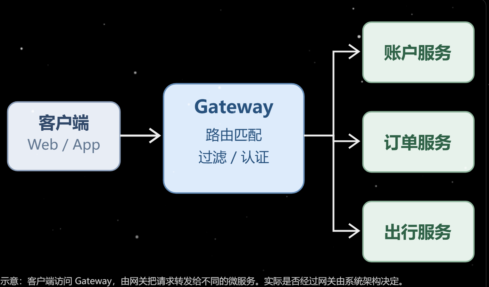
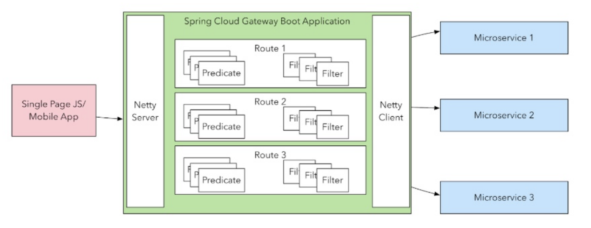
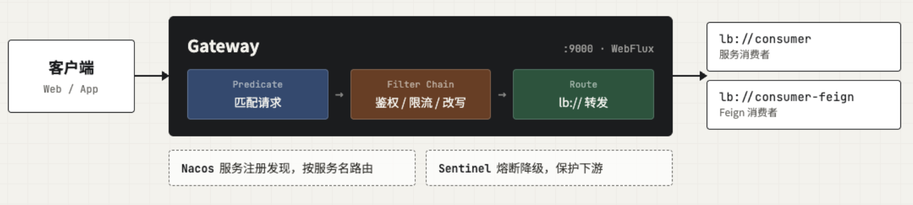
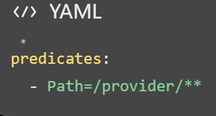
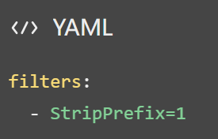
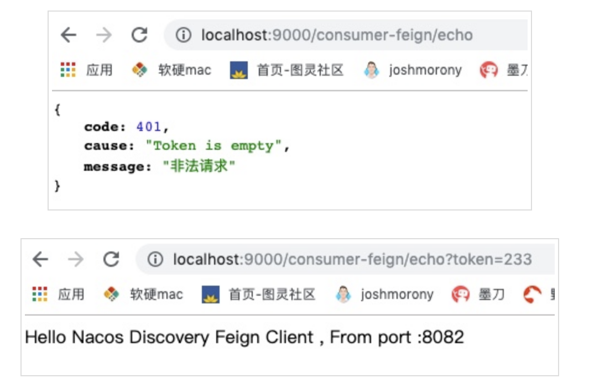
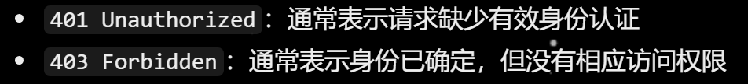

# Week6：服务网关与认证

## Spring Cloud Gateway 统一路由网关

### 为什么需要网关

在微服务架构中，一个系统通常由多个独立服务组成，每个服务都可能提供自己的 API；如果没有网关用户需要分别访问每个微服务：

+ 入口分散：客户端需要知道每一个服务的访问地址
+ 维护困难：服务地址或部署等发生改变时，客户端需要更改维护
+ 重复处理：每个微服务可能单独身份检查、限流等

因此 API 网关旨在为客户端提供统一的访问和处理的入口



### Spring Cloud Gateway 与其功能

**Spring Cloud Gateway** 是 Spring Cloud 提供的 API 网关组件，主要用于统一管理客户端到微服务的请求路由，并通过 **过滤器 Filter** 实现安全、监控、限流等公共处理。

功能：

+ 统一路由：根据请求条件转发到相应服务
+ 服务发现：结合 Nacos 注册中心等，通过服务名定位实例
+ 过滤处理
+ 安全与治理：认证、鉴权、限流等

### 网关的核心工作流程

#### 基础概念：

+ **Route 路由**：决定请求转发到哪个服务目标；路由实质上一套完整的转发规则，Predicate 和 Filter 是其组成部分
    - **Predicate 匹配条件**：根据匹配决定请求该走哪条路由
    - **Filter 过滤器**：不仅是过滤，主要对请求条件进行处理



#### 工作流程

假设我们已经启动了两个程序：

+ `gateway-service`：网关，运行在 `9000` 端口。
+ `provider-service`：服务提供者，运行在 `8081` 端口，提供 `/hello` 接口

---



1. 用户不直接访问服务提供者 `http://localhost:8081/hello`，而是访问网关：`http://localhost:9000/provider/hello`
2. 网关的监听端口接收到请求，**Predicate 判断请求符合哪条路由**（假设某条路由配置了这样一条匹配规则：

   

   ）Predicate 判断匹配这条路由
3. 这条路由的网关 Filter 继续处理请求：（假设过滤器配置了：

   

   ，那么这条请求 `/provider/hello` 就会去掉路径 1 个前缀，即被处理变成：`/hello`）
4. 处理完成后，网关这条路由会根据配置的 `uri: lb://provider-service`，找到名为 `provider-service` 的服务，并选择一个可用实例：`127.0.0.1:8081`
5. 最后，将处理完毕的 `/hello` 转发到 `http://127.0.0.1:8081/hello`
6. Provider 真正接收到请求，根据接口内容生成返回结果，结果会再经过网关，返回给请求的浏览器

## 网关过滤器 Filter

### Filter 的定位和作用

路由只能解决去哪个服务的问题，Filter 会对请求进行实质处理：

+ 检查是否登录，是否有权访问
+ 进行限流，限制固定时期内的访问数量
+ 修改请求路径、内容
+ 记录请求日志

### Filter 两种常见类型

+ `GatewayFilter`：对于指定路由的请求进行处理
+ `GlobalFilter`：对匹配到网关路由的请求统一生效，常用于身份检查、请求统计等。

## 常见的匹配条件与过滤规则

### Predicate 匹配请求

| 匹配方式 | 示例 | 含义 |
| --- | --- | --- |
| `Path` | `Path=/api/**` | 匹配指定路径 |
| `Method` | `Method=GET,POST` | 匹配 HTTP 请求方式 |
| `Header` | `Header=X-Source,app` | 匹配请求头 |
| `Query` | `Query=type,student` | 匹配查询参数 |
| `Host` | `Host=**.example.com` | 匹配主机名 |


### Filter 过滤请求

| 过滤器 | 作用 |
| --- | --- |
| `StripPrefix` | 去掉请求路径前面的若干段 |
| `RewritePath` | 按规则改写请求路径 |
| `AddRequestHeader` | 添加请求头 |
| `RequestRateLimiter` | 限制请求速率 |
| `Retry` | 对符合条件的失败请求重试 |


## 服务认证与授权

### 为什么需要统一认证

如果每个微服务都需要独立进行用户检查与认证，可能会出现重复代码、规则修改麻烦等问题

因此可以将公共身份检查放在网关

> 但涉及具体业务数据和操作权限时，后端服务仍应进行必要校验

### 认证 与 授权 的关系

+ 身份认证  Authentication：检查用户是否登录
+ 授权 / 权限控制 Authorization：检查用户的身份是否具有某些操作权限

**认证确认身份，授权决定权限**

### 身份凭证：Token

Token 是客户端访问系统时携带的身份凭证

1. 用户提交账号密码，服务进行身份认证
2. 验证成功，给客户端签发 Token
3. 客户端保存 Token
4. 客户端以后在访问 API 中携带 Token 访问
5. 服务端直接验证 Token 即可，通过后处理请求，无需再做额外的身份认证

### JWT

#### 定义

JWT：JSON Web Token，是一种用于在系统之间安全传递声明信息的 **Token** 格式

Spring Security 提供了相应的 JWT 验证支持

#### 经典签名 JWT 的组成


+ Header：说明 Token 类型、签名算法等
+ Payload：保存用户标识、过期时间等声明
+ Signature：用于检查与验证 Token 是否被篡改、是否由可信来源签发等

### 网关统一处理认证的流程

1. 用户登录
2. 认证服务验证身份，签发 JWT
3. 客户端每次请求业务 API 时都携带这个 JWT
4. Gateway 网关验证 JWT：
    1. 如果无效或过期：返回 401
    2. 如果有效，继续路由
5. 进入后端业务服务、检查用户业务权限、返回结果等后续操作




## Spring Cloud Gateway 的实际使用

### 建立网关服务，引入核心依赖

对于使用 Nacos 服务发现的 Gateway WebFlux 项目：

1. 创建独立的网关微服务：`gateway-service`
2. 在网关微服务的`pom.xml`中，找到`<dependencies>` 标签，导入以下核心依赖

```xml
<dependencies>

  <!-- Spring Cloud Gateway：网关 -->
  <dependency>
    <groupId>org.springframework.cloud</groupId>
    <artifactId>spring-cloud-starter-gateway-server-webflux</artifactId>
  </dependency>

  <!-- Nacos：服务注册与发现 -->
  <dependency>
    <groupId>com.alibaba.cloud</groupId>
    <artifactId>spring-cloud-starter-alibaba-nacos-discovery</artifactId>
  </dependency>

  <!-- Spring Cloud LoadBalancer：负载均衡 -->
  <dependency>
    <groupId>org.springframework.cloud</groupId>
    <artifactId>spring-cloud-starter-loadbalancer</artifactId>
  </dependency>

</dependencies>
```

3. 配置完后让 Maven 重新加载，下载并引入这些依赖

> [!NOTE]
> 这三个依赖分别负责：
>
> - Gateway：接收请求、匹配路由并转发
> - Nacos Discovery：查找注册的服务
> - LoadBalancer：选择具体服务实例

### 编写网关启动类

项目结构：

```plain
gateway-service
├── src
│   └── main
│       ├── java
│       │   └── com/example/gateway
│       │       └── GatewayServiceApplication.java
│       └── resources
│           └── application.yml
└── pom.xml
```

在`GatewayServiceApplication.java`中：

```java
package com.example.gateway;

import org.springframework.boot.SpringApplication;
import org.springframework.boot.autoconfigure.SpringBootApplication;

@SpringBootApplication
public class GatewayServiceApplication {

    public static void main(String[] args) {
        SpringApplication.run(
            GatewayServiceApplication.class, args
        );
    }
}
```

### 配置网关的路由规则

在`gateway-service` 的 `application.yml` 中写入：

```yaml
server:
  port: 9000

spring:
  application:
    name: gateway-service

  cloud:
    nacos:
      discovery:
        server-addr: 127.0.0.1:8848

    gateway:
      server:
        webflux:
          routes:
            - id: provider-route
              uri: lb://provider-service
              predicates:
                - Path=/provider/**
              filters:
                - StripPrefix=1
```

具体配置信息如下：

| 配置 | 作用 |
| --- | --- |
| `server.port: 9000` | Gateway 监听 9000 端口 |
| `id: provider-route` | 自定义路由标识 |
| `uri: lb://provider-service` | 根据 Nacos 中的服务名查找并选择实例   `lb://` 表示使用负载均衡机制定位服务   |
| `Path=/provider/**` | 匹配以 `/provider/` 开头的请求 |
| `StripPrefix=1` | 转发前去掉路径的第一段 |


### 自定义全局过滤器 GlobalFilter

在启动类所在包下创建 `filter` 子包，添加：`DemoAuthFilter.java`（模拟身份认证）

```plain
gateway-service
└── src/main/java
    └── com/example/gateway
        ├── GatewayServiceApplication.java
        └── filter
            └── DemoAuthFilter.java
```

```java
package com.example.gateway.filter;

import org.springframework.cloud.gateway.filter.GatewayFilterChain;
import org.springframework.cloud.gateway.filter.GlobalFilter;
import org.springframework.core.Ordered;
import org.springframework.http.HttpHeaders;
import org.springframework.http.HttpStatus;
import org.springframework.stereotype.Component;
import org.springframework.web.server.ServerWebExchange;
import reactor.core.publisher.Mono;

@Component
public class DemoAuthFilter implements GlobalFilter, Ordered {

    @Override
    public Mono<Void> filter(
            ServerWebExchange exchange,
            GatewayFilterChain chain) {

        // 1. 读取请求中的身份凭证
        String token = exchange.getRequest()
                .getHeaders()
                .getFirst(HttpHeaders.AUTHORIZATION);

        // 2. 没有正确凭证，拒绝请求
        if (!"Bearer class-demo".equals(token)) {

            exchange.getResponse()
                    .setStatusCode(HttpStatus.UNAUTHORIZED);

            return exchange.getResponse().setComplete();
        }

        // 3. 凭证符合要求，继续处理请求
        return chain.filter(exchange);
    }

    @Override
    public int getOrder() {
        return -1;
    }
}
```

### 启动服务

依次启动：Nacos 注册中心、服务提供者服务、网关服务即可

<!-- learning-journey:update-history:start -->
## 更新记录

| 日期 | 类型 | 说明 |
| --- | --- | --- |
| 2026-10-25 | 首次发布 | 从语雀整理并发布到学习记录仓库 |
<!-- learning-journey:update-history:end -->
