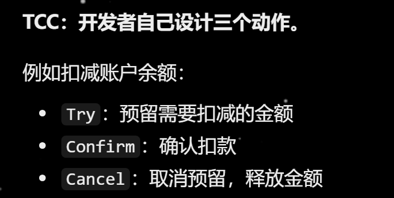

# Week7：分布式事务

## 事务的基本概念

### 事务的定义

事务（Transaction）是由一组操作组成的执行单元，用于保证这些操作按照约定整体完成或回滚

> 例如电商系统中，用户完成一次下单，需要执行三个操作：
>
> 1. 创建订单
> 2. 扣减商品库存
> 3. 扣减用户账户余额
>
> 正常情况下，三个操作都成功，才算完成一次订单业务
>
> 如果在某个步骤发生错误，不能出现“订单已经创建，但库存和余额没有正确更新”的情况，应该整个事务进行回滚撤销

### 事务的 ACID 特性

- **A — Atomicity 原子性**：一组操作视为一个整体完成，失败时回滚
- **C — Consistency 一致性**：事务执行前后，数据应满足约定的完整性约束和业务约束
- **I — Isolation 隔离性**：并发事务不能互相干扰（应有隔离控制机制）
- **D — Durability 持久性**：已经成功提交的事务结果应持久保存

### 本地事务 v.s. 分布式事务

#### 本地事务 Local Transaction：

传统的单体应用中，多个业务模块可能同时使用同一个数据库

参与同一个本地事务的操作可以使用 Spring 的 `@Transactional` 统一管理

```java
@Transactional(rollbackFor = Exception.class)
public void createOrder(Order order) {

orderMapper.insert(order);
stockMapper.deduct(order);
accountMapper.pay(order);
}
```

- 如果全部正常执行：事务提交
- 如果中途发生任何异常：事务回滚

`@Transactional` 使这些数据库操作受到同一个本地事务的管理

#### 分布式事务

系统拆分成微服务后，每个服务可能拥有单独的数据库

而普通的 `@Transactional` 只能管理它所关联事务管理器覆盖的本地事务，不能自动回滚其他微服务数据库中的操作

因此，需要额外的机制来协调多个本地事务，这就是**分布式事务**要解决的问题

## Seata：分布式事务协调框架

### Seata 的定位和作用

Seata 是一个开源的分布式事务解决方案，通过协调多个服务中的分支事务，帮助业务实现全局事务的一致性要求

Seata 的作用在于：协调各个服务中的本地事务，让它们共同参与一次全局事务

### Seata 核心组件与相关概念

#### TC 事务协调器 Transaction Coordinator

通常运行在独立的 Seata Server 中

用于维护全局事务和分支事务状态，协调全局提交或回滚（负责协调各个参与者）

#### TM 事务管理器 Transaction Manager

TM 一般都是集成到业务应用中

用于开启全局事务，决定全局提交和回滚（发起和决定整个事务）

#### RM 资源管理器 Resource Manager

RM 一般也集成到业务应用中

用于管理本地分支事务，向 TC 注册并执行相应操作（实际管理各分支的数据操作）

#### XID 全局事务 ID

用于标识一次全局事务，让不同服务中的分支事务知道自己归属于哪一次业务操作

### 核心组件的主要配合过程：

1. **TM 开启全局事务**：向 TC 申请创建全局事务，获得 XID
2. **服务间传播 XID**：服务 A 调用服务 B、服务 C，让他们获得 XID 并加入全局事务
3. **RM 注册分支事务**：各服务管理自己的本地事务，并将分支信息报告给 TC
4. **全局事务结束**：TM 根据业务执行结果请求全局提交或回滚，由 TC 协调相关 RM 完成后续操作

### Seata 的四种事务模式

- AT 模式：自动记录回滚日志，失败时补偿
- TCC 模式：开发者实现 Try、Confirm、Cancel；自定义事务处理能力强，但业务开发复杂度较高
- Saga 模式：依次执行业务步骤，失败时执行补偿操作； 适用于长流程、长事务、多系统协作
- XA 模式：依靠数据库 XA 协议进行两阶段提交；强一致性能力较强，但资源锁定和性能成本较高




## Seata AT 模式工作流程

### AT 模式基本概念

AT（Automatic Transaction）是 Seata 提供的一种自动补偿型分布式事务模式

在满足数据库、SQL、数据源代理等支持条件时，Seata 可以记录数据修改前后的信息，必要时使用这些信息进行回滚

**`undo_log`：记录分支事务回滚所需的数据，用来帮助恢复本次事务修改前的内容**

### 工作流程：

1. 第一阶段：执行并提交本地事务

   在单个服务（假设服务 A）中执行具体操作，并记录修改前后的数据，保存到 `undo_log` 中，完成后提交本地事务
2. 第二阶段：根据全局结果提交或回滚

   假如另一服务的本地事务失败（假设服务 B），TM 会发起全局回滚，TC 通知相关 RM 回滚 → A 服务查找 `undo_log`，根据回滚记录恢复操作

   而如果所有服务都执行成功，则进入全局提交流程，AT 模式主要是进行回滚日志的异步处理

## Seata 的实际使用

### 确定业务与服务结构

本次实际使用案例：

以电商下单为例，一次下单需要完成三个操作：

1. 订单服务：创建订单
2. 库存服务：扣减库存
3. 账户服务：扣减用户余额

由于三个服务分别操作自己的数据库，需要使用 Seata 协调分布式事务

```plain
客户端发起下单请求
         ↓
order-service（订单服务）
         │
         ├── 创建订单 → order_db
         │
         ├── 调用 stock-service
         │             └── 扣减库存 → stock_db
         │
         └── 调用 account-service
                       └── 扣减余额 → account_db
```

### 创建 AT 模式的 `undo_log` 表

AT 模式中，每个参与 AT 事务的业务数据库都需要准备 `undo_log` 表；且建表 SQL 应使用与当前 Seata 版本、数据库类型匹配的官方脚本

```plain
order_db
├── orders
└── undo_log

stock_db
├── stock
└── undo_log

account_db
├── account
└── undo_log
```

### 准备并配置 Seata Server

下载与项目兼容的 Seata Server 后，在其配置文件中设置注册中心（`Seata Server 安装目录/conf/application.yml`）

```yaml
seata:
  config:
    type: file

  registry:
    type: nacos
    nacos:
      application: seata-server
      server-addr: 127.0.0.1:8848
      group: SEATA_GROUP
      cluster: default

  store:
    mode: file
```

- `registry.type: nacos`：将 Seata Server 注册到 Nacos
- `application: seata-server`：注册的服务名
- `group: SEATA_GROUP`：注册分组
- `cluster: default`：所属集群
- `store.mode: file`：本地实验使用文件方式保存协调器状态

### 在微服务项目中引入核心依赖

```xml
<dependencies>

  <!-- Spring Web：提供 HTTP API -->
  <dependency>
    <groupId>org.springframework.boot</groupId>
    <artifactId>spring-boot-starter-web</artifactId>
  </dependency>

  <!-- Nacos：服务注册与发现 -->
  <dependency>
    <groupId>com.alibaba.cloud</groupId>
    <artifactId>spring-cloud-starter-alibaba-nacos-discovery</artifactId>
  </dependency>

  <!-- Seata：分布式事务 -->
  <dependency>
    <groupId>com.alibaba.cloud</groupId>
    <artifactId>spring-cloud-starter-alibaba-seata</artifactId>
  </dependency>

  <!-- MySQL 驱动 -->
  <dependency>
    <groupId>com.mysql</groupId>
    <artifactId>mysql-connector-j</artifactId>
    <scope>runtime</scope>
  </dependency>

  <!-- OpenFeign：服务之间进行远程调用 -->
  <dependency>
    <groupId>org.springframework.cloud</groupId>
    <artifactId>spring-cloud-starter-openfeign</artifactId>
  </dependency>

<!-- LoadBalancer：选择服务实例 -->
  <dependency>
    <groupId>org.springframework.cloud</groupId>
    <artifactId>spring-cloud-starter-loadbalancer</artifactId>
  </dependency>

</dependencies>
```

配置完成后，重新加载 Maven 项目

### 配置各微服务连接 Nacos、Seata、数据库

在各服务的 `application.yml` 中进行配置：

```yaml
server:
  port: 8081

spring:
  application:
    name: order-service

  cloud:
    nacos:
      discovery:
        server-addr: 127.0.0.1:8848

  datasource:
    url: jdbc:mysql://127.0.0.1:3306/order_db
    username: ${DB_USERNAME}
    password: ${DB_PASSWORD}

seata:
  enabled: true

  # 当前服务所属的事务分组
  tx-service-group: demo_tx_group

  # AT 模式数据源代理
  enable-auto-data-source-proxy: true
  data-source-proxy-mode: AT

  # 通过 Nacos 查找 Seata Server
  registry:
    type: nacos
    nacos:
      application: seata-server
      server-addr: 127.0.0.1:8848
      group: SEATA_GROUP

  # 事务分组与 TC 集群的映射
  service:
    vgroup-mapping:
      demo_tx_group: default

  config:
    type: file
```

采用 Seata 本地文件配置 + Nacos 服务注册发现的组合方式

客户端与 Seata Server 的服务名、分组、集群、命名空间必须一致，才能发现正确的 TC 实例

### 本地事务和全局事务编写

在库存服务中编写本地事务：

```java
@Service
public class StockService {

    @Transactional(rollbackFor = Exception.class)
    public void deduct(Long productId, int count) {

        // 扣减数据库中的商品库存
        stockMapper.deduct(productId, count);
    }
}
```

在订单服务中，开启全局事务

```java
@Service
public class OrderBizService {

    // 省略三个依赖的声明及构造器注入：
    // orderLocalService、stockClient、accountClient

    @GlobalTransactional(rollbackFor = Exception.class)
    public void createOrder(Order order) {

        // 1. 调用本地事务方法创建订单
        orderLocalService.save(order);

        // 2. 通过 Feign 调用库存服务
        stockClient.deduct(
            order.getProductId(),
            order.getCount()
        );

        // 3. 通过 Feign 调用账户服务
        accountClient.pay(
            order.getUserId(),
            order.getAmount()
        );
    }
}
```

如果库存或账户服务只返回失败码，订单服务要检查返回结果并抛出异常，才能让这个示例里的 `@GlobalTransactional` 触发全局回滚。

### 启动服务

依次启动：数据库、Nacos、Seata Server、相应微服务即可

<!-- learning-journey:update-history:start -->
## 更新记录

| 日期 | 类型 | 说明 |
| --- | --- | --- |
| 2026-11-18 | 首次发布 | 从语雀整理并发布到学习记录仓库 |
<!-- learning-journey:update-history:end -->
