# 第四章第二节：软件测试方法——白盒测试

## 白盒测试概述

### 白盒测试的概念

白盒测试，又称结构性测试

白盒测试的对象系统内部清晰可见，基于被测程序的源代码设计测试用例

白盒测试要求对被测程序的结构特性做到一定程度的覆盖，并以测试用例的覆盖程度度量测试效果；也称为基于覆盖的测试技术

### 白盒测试的基本流程

1. 读代码进行分析

2. 设计测试用例
3. 执行测试用例

4. 分析覆盖率等测试结果

### 白盒测试的优点

+ 能测代码内部细节

+ 能按选定的覆盖标准检查程序内部结构，并提供覆盖率
+ 通过分支覆盖等方法，可以检查逻辑判断的真、假分支

+ 结果更可信

## 控制流图（Control-Flow-Graph，CFG）

### 定义

控制流图是用图符号表示程序执行期间可能穿过的所有路径的图形化模型

图的节点是程序的语句，图的边代表了程序的执行

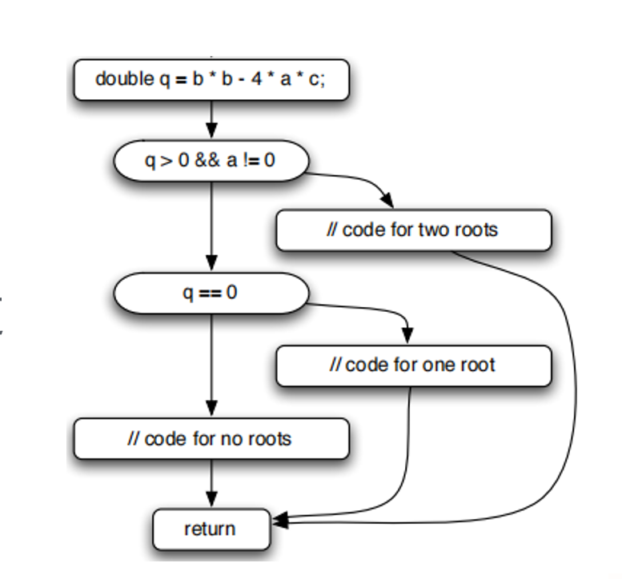

### 关键特性

**控制流图中存在一条路径≠这条路径在实际执行中存在**

例：

```cpp
void checkNumber(int x) {
    // 节点 1：第一个条件判断
    if (x > 10) {
        printf("x 大于 10\n"); // 节点 2
    }

    // 节点 3：第二个条件判断
    if (x < 5) {
        printf("x 小于 5\n"); // 节点 4
    }
}
```

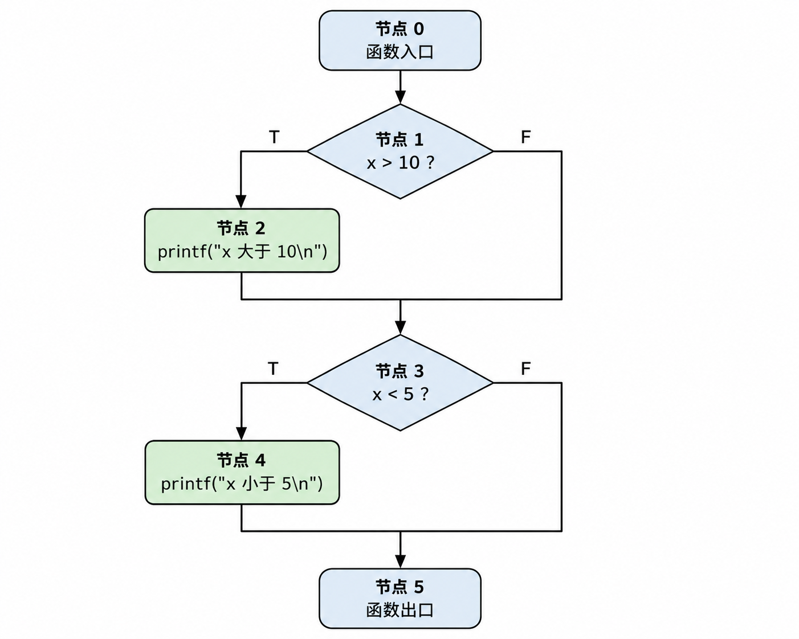

$`\text{节点 1 (True)} \longrightarrow \text{节点 2} \longrightarrow \text{节点 3 (True)} \longrightarrow \text{节点 4}`$的控制流图是连通的，但实际上是不可达的

### 控制流图的构造

由外向内递归地构造：

先绘制最外层的控制结构（`if` / `while` / `do-while` / `for` / `switch` 等）对应的节点框，再对内部语句块进一步展开

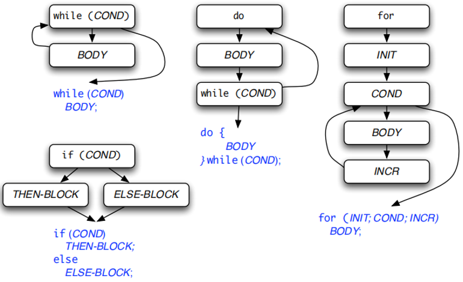

## DD 路径图（Decision-to-Decision Path）

### 出现原因

控制流图中大量串行语句会使图节点过密，如下图；通过将连续无分支的路径化简为单点，可极大地压缩图规模

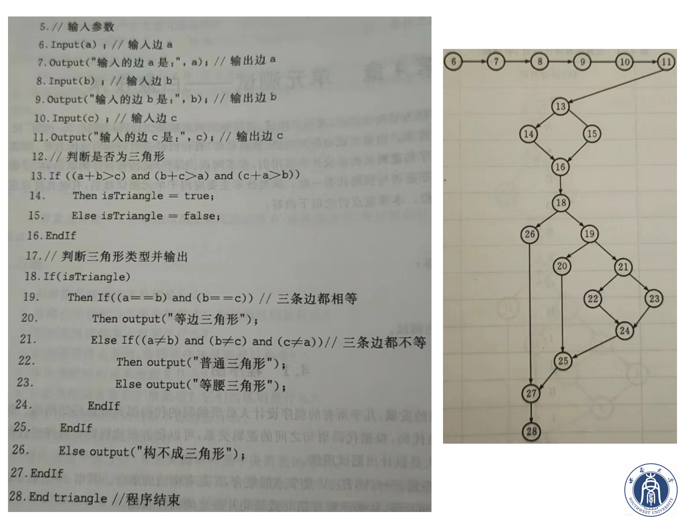

### DD 路径定义 / 判定

如果控制流图中的一条路径满足：

1. 从程序最开头或者一个判定框（控制结构）出发

2. 结束于程序最末尾或者另一个判定框
3. 中间不包含任何判定框（分支判断）

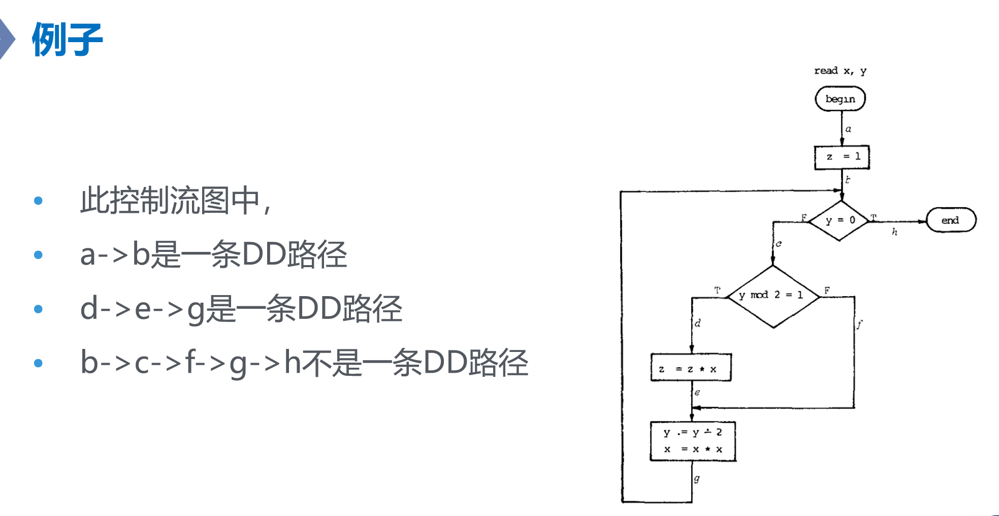

### DD 路径图：

将控制流图的全部串行语句都变成 DD 路径，就把控制流图转换成了 DD 路径图

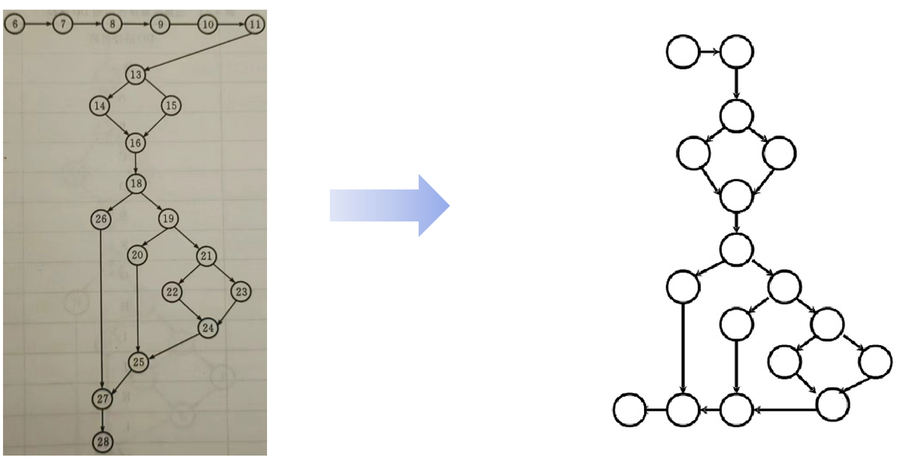

## 基于程序图的覆盖标准

为了衡量一套测试用例所提供的测试是否充分，白盒测试提供了两套不同粒度的覆盖体系：**基于程序图的图覆盖**和**基于分支条件的逻辑覆盖**

> 覆盖率的价值在于告诉用户哪些错误模式没有测试，而不是保证测试过的测试用例对应的错误模式没有包含错误
>
> 低覆盖率说明测试不足，高覆盖率却不能保证正确
>

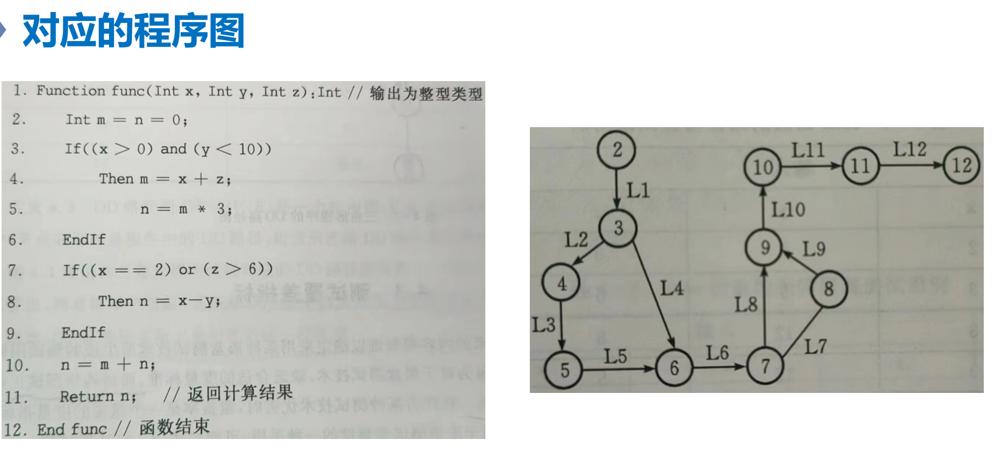

### 节点覆盖率

+ 覆盖标准：测试用例执行后，总计程序图中所有节点被访问至少一次

+ 覆盖率：$`\frac{\text{测试用例执行的程序图中节点数目}}{\text{程序图中节点总数}}`$

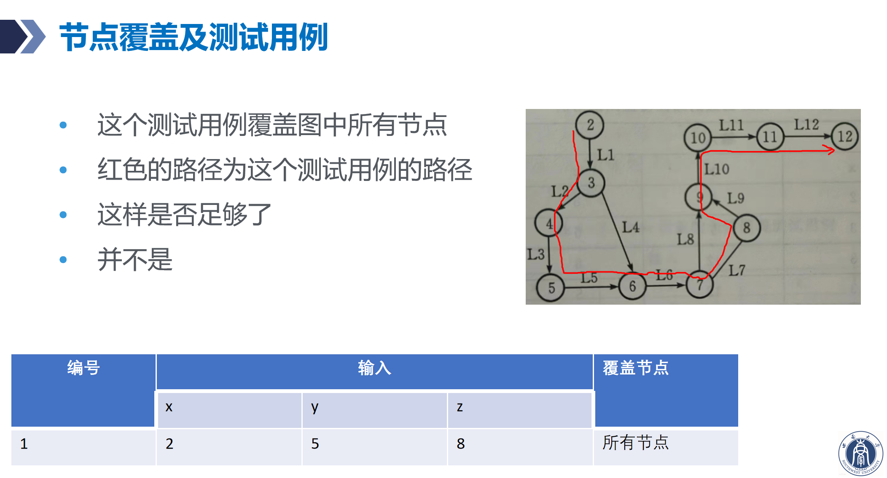

### 边覆盖率

+ 覆盖标准：测试用例执行后，总计程序图中所有边被访问至少一次

+ 覆盖率：$`\frac{\text{测试用例执行的程序图中边数目}}{\text{程序图中边总数}}`$

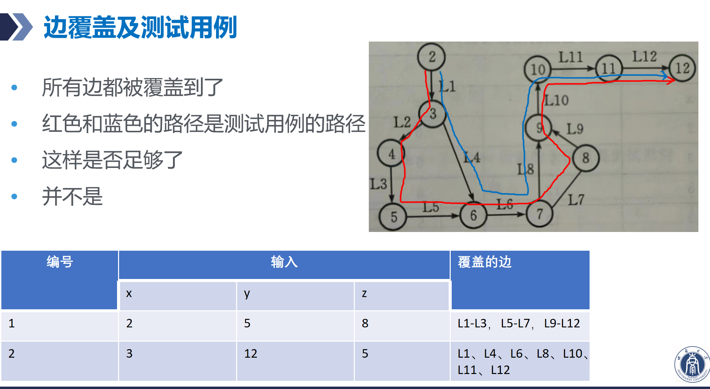

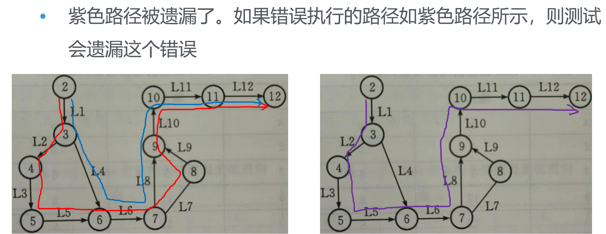

### 路径覆盖率

+ 覆盖标准：测试用例执行后，总计程序图中所有路径被访问至少一次

+ 覆盖率：$`\frac{\text{测试用例执行的程序图中路径数目}}{\text{程序图中路径总数}}`$

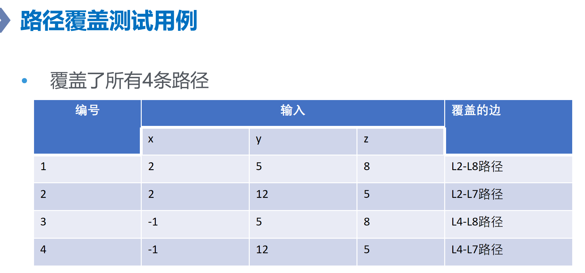

## 基于逻辑的覆盖

> 基于图的覆盖的粒度是点和边，是不足的；
>
> 例如对闰年判断的代码，`year=400`和`year=300`两个测试用例有着同样的执行路径，前者不展示错误而后者展示错误，因后者进入((year%4==0) ||(year%400!=0))并通过了这个判断，而基于逻辑的覆盖可以进行更加细致的覆盖
>

### 判定覆盖 Decision Coverage / 分支覆盖

#### 要求：

每个判定语句的取真（True）和取假（False）分支至少执行一次

#### 局限：

只关注整个判定的最终输出，忽视判定内部各个子条件的取值

### 条件覆盖 Condition Coverage

#### 要求：

每个判定中的每个独立原子条件的真值和假值至少出现一次

### 条件/判定覆盖 Condition/Decision Coverage, C/DC

#### 要求：

同时满足每个判定语句的真/假分支至少出现一次，且每个原子条件的真/假值至少出现一次

### 条件组合覆盖 Multiple Condition Coverage

#### 要求：

每个判定中所有原子条件的每一种可能取值组合都必须至少出现一次

#### 局限：

测试用例数随单个判定内条件数量呈指数级 $`2^n`$ 增长；且若子条件间不独立，部分逻辑矛盾的组合在物理上不可达

### 修改的条件/判定覆盖 MC/DC, Modified Condition/Decision Coverage

#### 四大准则：

1. 每个程序的调用点和返回点均被调用

2. 每个判定均取过所有可能的输出结果（True/False）
3. 判定中的每个条件均取过所有可能的输出结果（True/False）

4. 每一个条件都能独立影响判定的最终输出结果

#### MC / DC 的判定：

MC/DC首先要求实现条件/判定覆盖

此外对于每一个条件C，要求存在符合以下条件的两次计算：

1. 条件C所在判定内的所有其他条件的取值完全相同

2. 条件C的取值相反，且C所在的判定的计算结果相反

#### 优点

MC/DC 在典型情况下可用 $`n + 1`$ 个测试用例实现（$`n`$ 为条件数），相比条件组合覆盖能显著降低测试成本；实际数量取决于判定结构

## 基本路径测试

> 全路径覆盖因循环问题在工程上不可行（天文数字）；
>
> 基本路径测试（Basis Path Testing）提供了一种具有严密数学理论保障的替代方案：将路径编码为向量，只需测试一组“线性无关”的典型路径基，即可覆盖控制流图中的所有边
>

### 回顾：线性代数知识——线性无关

给定向量$`v_1,...,v_n`$，如果存在不是全为零的数字$`a_1,...,a_n`$，使得$`a_1v_1+...+a_nv_n=0`$，则称向量$`v_1,...,v_n`$是线性相关的；否则，称向量$`v_1,...,v_n`$是线性无关的

### 路径向量编码

给定一个包含 $`e`$ 条边的 DD 路径图，每条路径可编码为一个 $`e`$ 维向量，向量第 $`i`$ 个元素代表该路径经过第 $`i`$ 条边的次数

### 基本路径基

路径集合 $`S = \{s_1, s_2, \dots, s_k\}`$ 满足：

+ $`S`$ 中路径对应的向量**彼此线性无关**；

+ 图中任意一条可能路径 $`v`$ 对应的向量，均可表示为 $`S`$ 中路径向量的**线性组合**（即 $`v = \sum b_i v_i`$）

基本路径基**不唯一**，但基中包含的线性无关路径数量 $`k`$ 是固定且唯一的

### 圈复杂度

#### 定义

圈复杂度 $`V(G)`$ 度量了控制流图的程序复杂性，且**精确等于基本路径基中的线性无关路径数量**

#### 计算公式

$`e`$ 为边数，$`n`$ 为节点数：

+ **强连通图**（存在从出口回到入口的隐式边）：$`V(G) = e - n + 1`$

+ **非强连通图 / 单入口单出口图（标准公式）**：$`V(G) = e - n + 2`$
+ **判定节点计数法**：$`V(G) = P + 1\quad (\text{其中 } P \text{ 为图中的判定节点数})`$

### 构造基本路径基的方法

给定一个单入口单出口的DD路径图，求这个DD路径图的基本路径基S：

1. 初始S为空集

2. 基路径 1： 给出一条从入口到出口的最短路径，把这条路径加入S路径
3. 迭代：
    1. 检查 $`S`$ 中已有的路径，找到路径上**第一个尚未完全覆盖（未取遍真假分支）的分支节点**
    2. **强制该分支节点选择另一个未走的路径分支走向点** $`a`$
    3. 从点 $`a`$ 开始，按**最短路径**走向出口，形成新路径并加入 $`S`$

4. **终止条件**：重复上述过程，直到图中所有分支节点的每个分支均被完全覆盖，此时 $`|S| = V(G)`$

### 基本路径测试的流程：

绘制代码的 DD 路径图 ──▶ 计算圈复杂度 V(G) ──▶ 构造 V(G) 条线性无关的基本路径基 ──▶ 设计测试用例覆盖每条基本路径

### 示例：

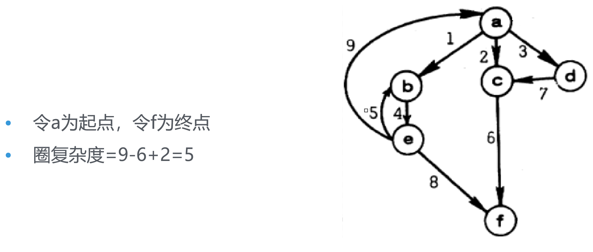

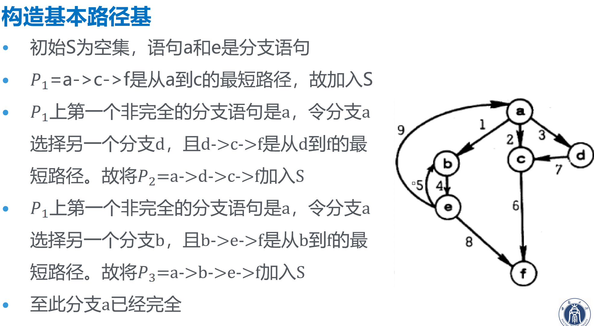

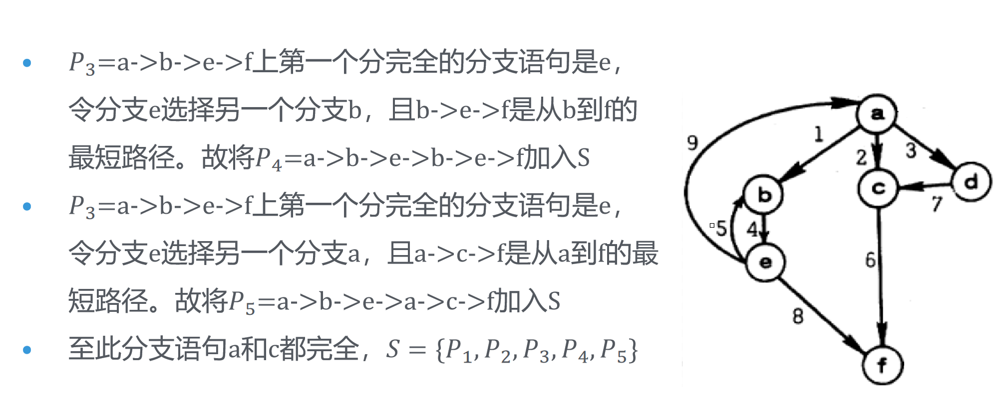

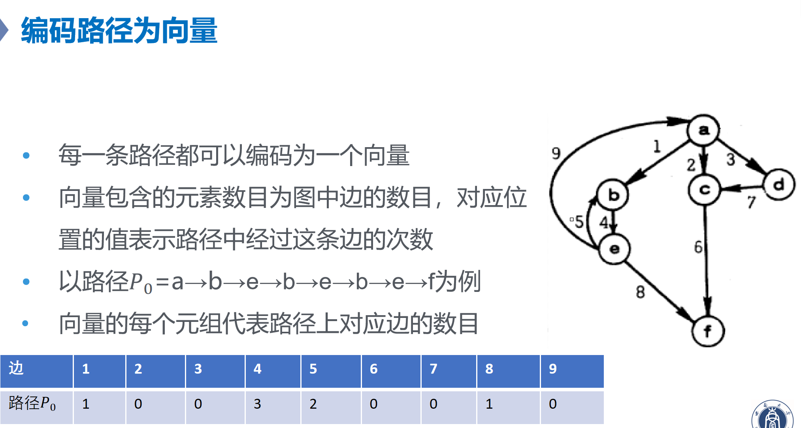

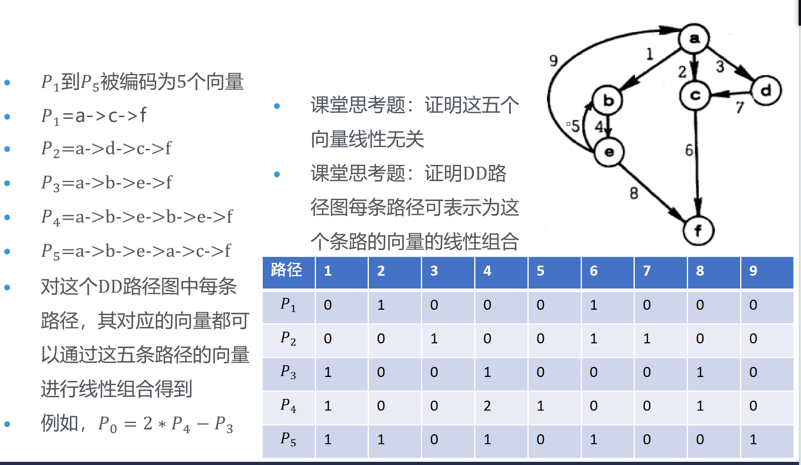

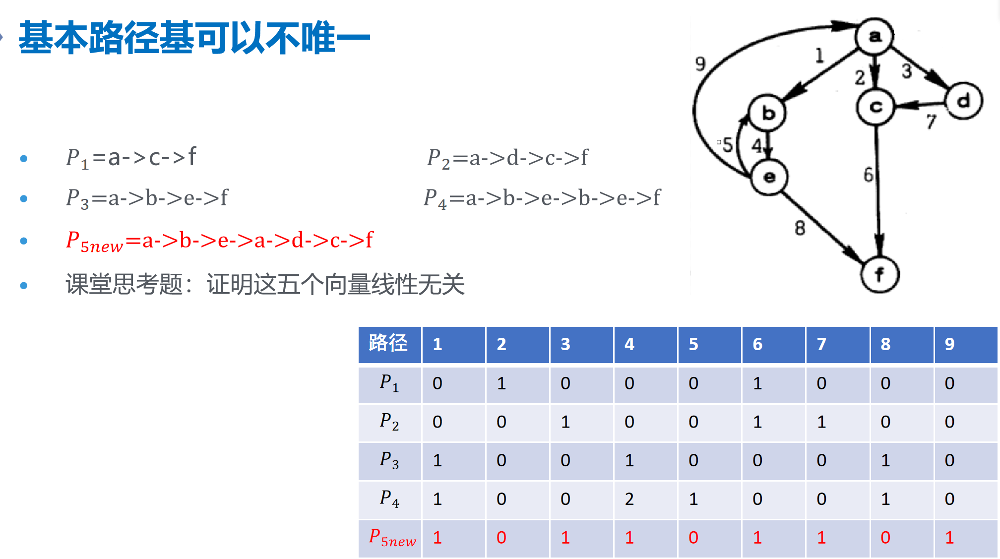

## 数据流测试

> 程序不仅是控制流的转移，更是**数据变量的生命周期演化**
>
> 基于图和逻辑的覆盖侧重于控制逻辑，而**数据流测试（Data Flow Testing）**则从“变量定义与使用”的角度对程序行为进行深度覆盖
>

### 数据流分析的基本概念

> 数据的动作可以分为定义与使用
>

#### 数据定义

变量被赋值或分配空间，包括：

+ 变量声明

+ 变量初始化
+ 在赋值语句中处于赋值符号左边

+ 通过scanf等给变量赋值
+ 执行过程时参数被调用者实例化

+ 动态内存分配
+ 打开文件

#### 数据使用

变量在计算或控制中被读取，包括：

+ 出现在表达式之中

+ 作为参数传递
+ 出现在条件语句中

+ 出现在printf等语句中
+ 出现在return语句中

+ 对文件对象进行读写

### 数据使用的分类

#### 谓词使用 p-use

指数据作为谓词的一部分被使用，即在控制分支谓词/条件判断中被使用

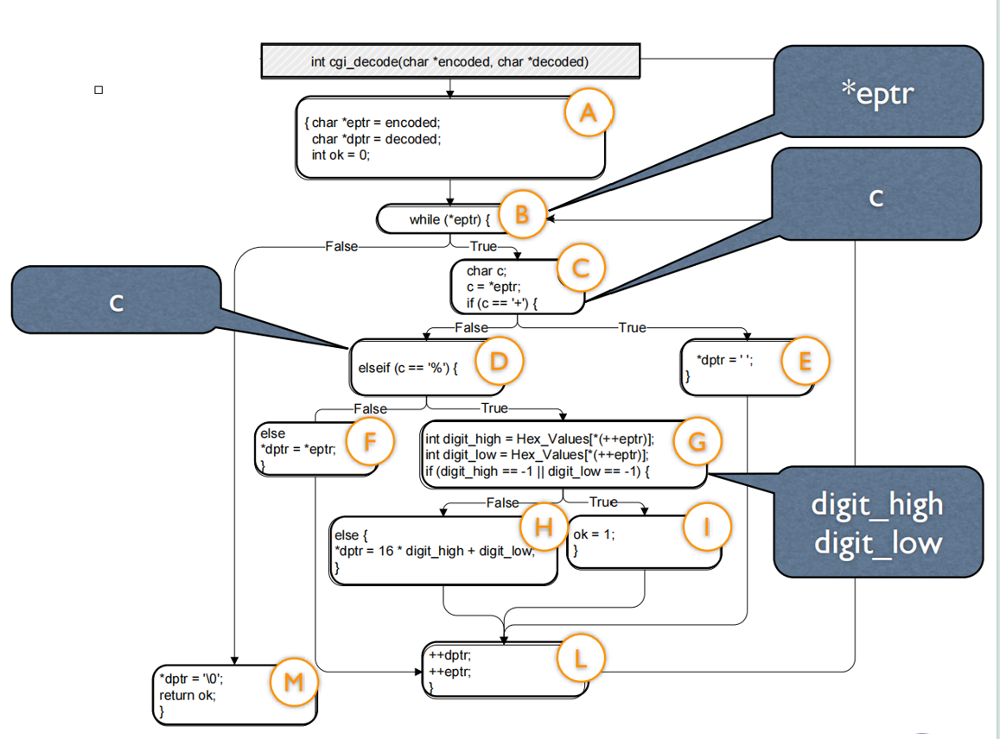

#### 计算使用 c-use

指数据以其他方式使用，尤其是在计算中使用

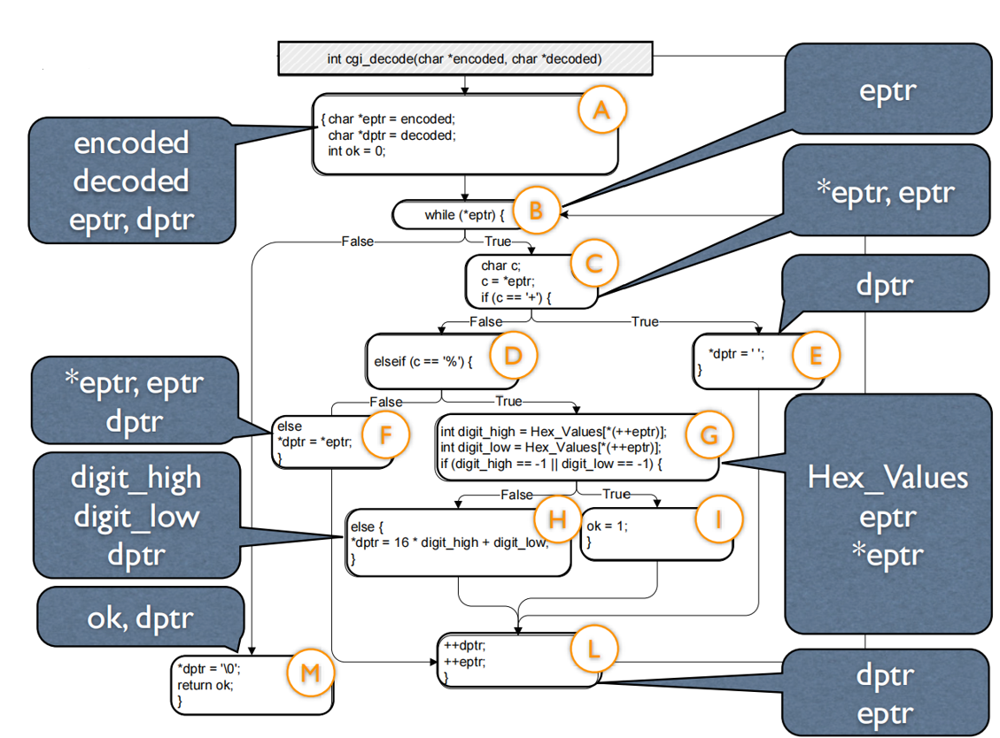

### 其他概念定义

+ 定义节点：某变量在某节点处被定义，该节点则是该变量的定义节点

+ 使用节点：某变量在某节点处被使用，该节点则是该变量的使用节点
+ 谓词使用节点：某变量在某节点处被使用在谓词中，该节点则是该变量的谓词使用节点

+ 计算使用节点：某变量在某节点处被以其他方式使用，该节点则是该变量的计算使用节点
+ **定义-使用路径：图中一条开始于某变量的定义节点，且终止于同一变量的使用节点的路径**

+ **定义-清除路径：开始于某变量的定义节点，终止于同一变量的使用节点的路径，且路径上其他节点不是该变量的定义节点（没有任何其他节点对变量重新进行定义）**

### 数据流覆盖指标

测试用例集合 $`S`$ 需要覆盖不同的数据流契约：

#### 全定义标准

对每个变量 $`v`$ 及其每个定义节点 $`a`$，$`S`$ 中至少有一条测试路径包含从 $`a`$ 到 $`v`$ 的**某个使用节点**的定义-清除路径

#### 全使用标准

对每个变量 $`v`$、每个定义节点 $`a`$ 以及**每个使用节点** $`f`$，$`S`$ 均需包含从 $`a`$ 到 $`f`$ 的定义-清除路径；对 $`f`$ 的每个后继节点均需覆盖（不仅要让程序运行到使用变量 $`v`$ 的 $`f`$ 节点，如果 $`f`$ 节点是一个分支判断，还必须把从 $`f`$ 出发走向所有“后继节点”的分支路径（如 True 分支和 False 分支）都测试到）

#### 全谓词使用/部分计算标准

对每个定义节点，必须覆盖到其所有 p-use 节点的定义-清除路径；若变量无 p-use，则至少覆盖一个 c-use 节点

#### 全计算使用/部分谓词标准

对每个定义节点，必须覆盖到其所有 c-use 节点的定义-清除路径；若变量无 c-use，则至少覆盖一个 p-use 节点

#### 全定义-使用路径标准

对每个定义节点和使用节点对 $`(a, f)`$，必须覆盖其间**所有无环或仅执行环一次的定义-清除路径**

### 示例

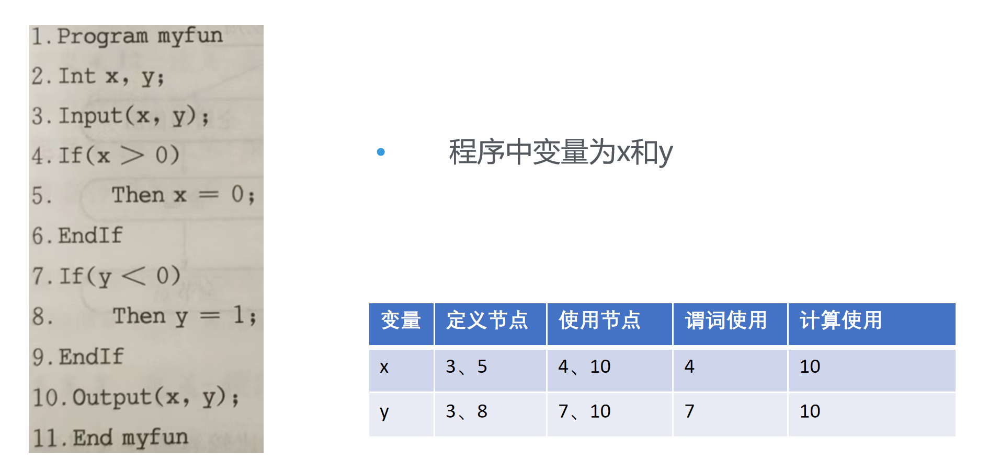

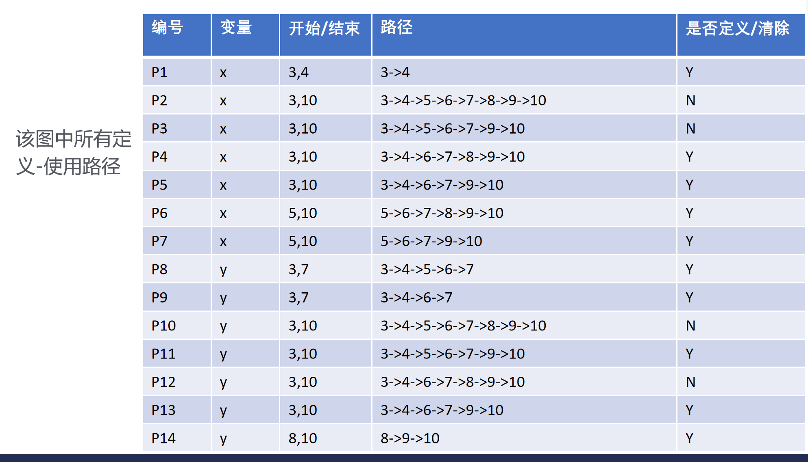

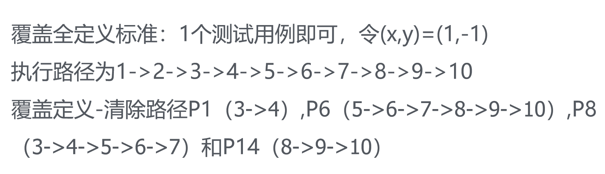

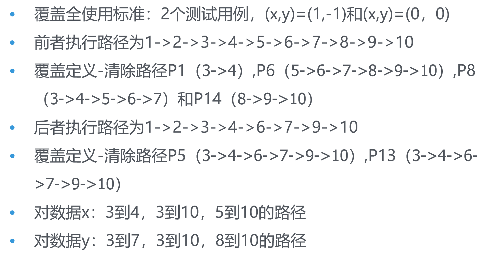

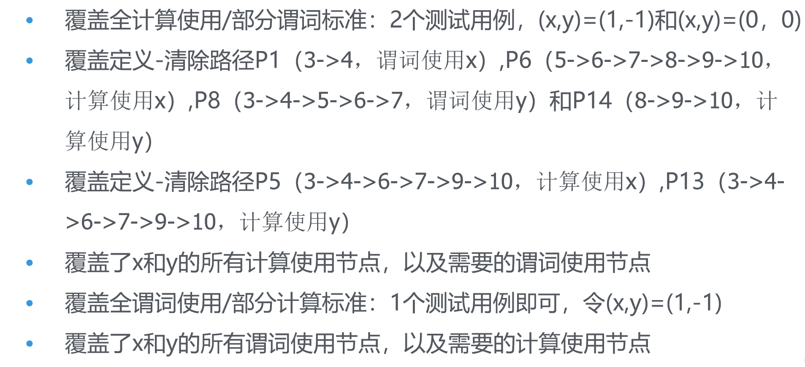

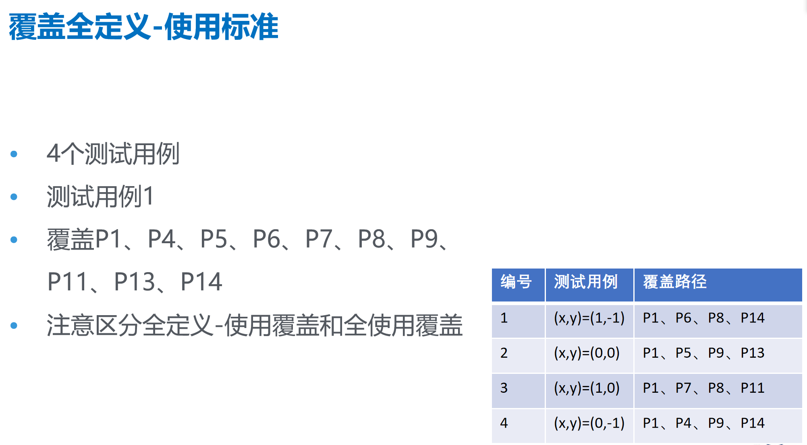

## 覆盖指标之间的关系

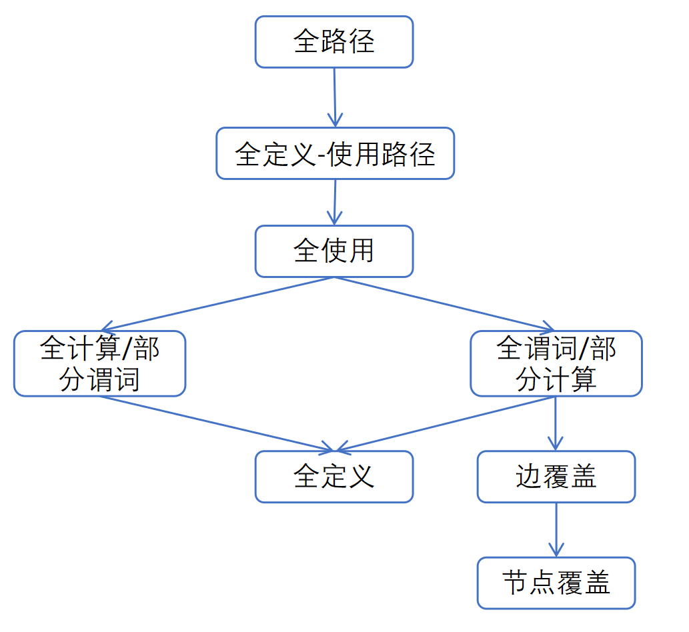

<!-- learning-journey:update-history:start -->
## 更新记录

| 日期 | 类型 | 说明 |
| --- | --- | --- |
| 2026-10-25 | 首次发布 | 从语雀整理并发布到学习记录仓库 |
<!-- learning-journey:update-history:end -->
