# 第五章：单元测试与集成测试

## 代码的静态测试与评审

> 在正式编写并执行动态测试用例进行单元测试或集成测试之前，最经济、高效的缺陷拦截手段是**静态测试**

### 编码的标准与规范

- MISRA C：工业级 C 语言编码标准
- Google C++ Style Guide、Google Java Style Guide：企业级编码规范

严格遵守标准规范可显著增强程序的**可读性、可靠性、可维护性和可移植性**

### 代码评审形式

代码审查能提前发现代码中 **60% 以上的缺陷**，**是跨团队共享知识和保障规范的核心手段**

单次审查代码量建议在 **200～400 行**，审查速率控制在 **300～500 LOC/hour**

**主要形式包括：代码互查（peer review）、代码走查、会议审查**

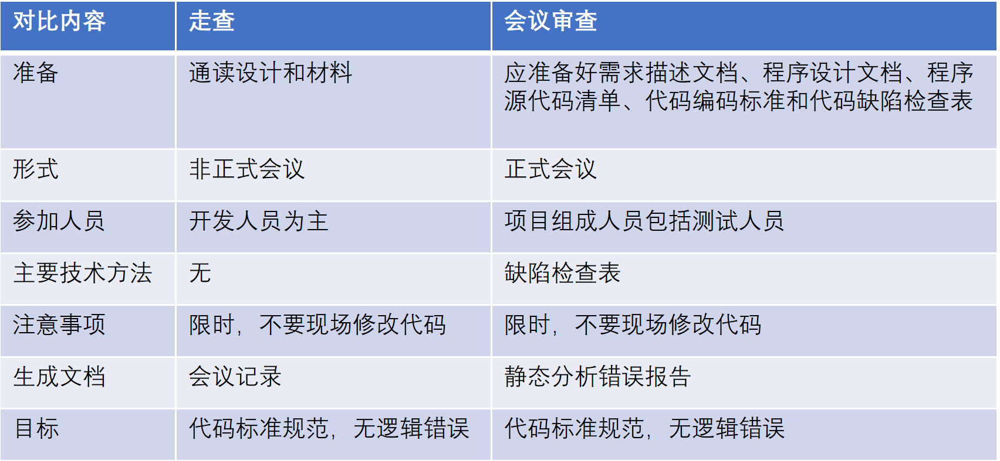

#### 代码走查 Walk-through

以开发人员为主，在走查前通读设计和编码，采用讲解、讨论、模拟运行的方式进行的查找错误的活动，检查要点是代码是否符合标准和规范，是否有逻辑错误

- 限时——避免跑题
- 发现问题适当记录——避免现场修改

#### 会议审查 Inspection

由程序编写小组逐句阐明程序的逻辑，按**缺陷检查表**逐个检查，记录已确定缺陷，形成评审报告，根据错误记录决定是否重新进行评审

### 代码评审的价值

1. 改善代码质量
2. 跨团队共享知识
3. 辅导缺乏经验的程序员
4. 坚持遵守代码规范
5. 增强协作
6. 减少项目代价

### 代码静态检测工具（了解）

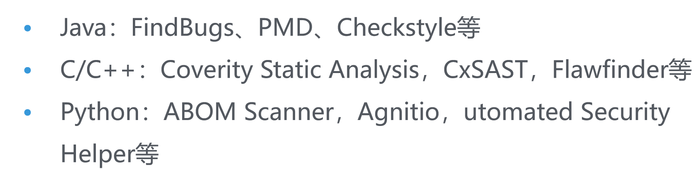

- SonarLint 是一个免费且开源的 IDE 插件，在本地提供实时打字分析

## 单元测试

### 单元测试的定位与目标

单元测试能以最低的成本在开发最早阶段消除缺陷，单元测试是系统质量的基石，可以比系统测试测得更彻底

单元测试的测试对象是：软件设计的最小可测试单元（函数、类、模块）

### 单元测试的价值

- 支持代码重构扩展：单元测试是各种类型测试的基础
- 单元测试引导更好的代码设计
- 避免回归缺陷
- 节省测试时间
- 规范行为和记录代码等

### 单元测试的要求与六大核心任务

单元测试要求对代码的规范性，正确性，安全性，性能进行测试

- **模块独立执行路径测试**：保证被测单元内每条语句至少执行一次，排查算符优先级、初始化与符号错误
- **局部数据结构测试**：检查存储变量的完整性、类型不匹配、上溢/下溢及默认值异常
- **模块接口测试**：检查实参与形参在个数、类型、量纲及调用顺序上的一致性，防止只读参数被意外修改
- **单元边界条件测试**：覆盖合法边界（内部临界点）与非法边界（外部临界点）
- **单元容错测试**：检验预设的错误处理流程是否生效，异常信息是否清晰准确
- **内存分析**：排查动态内存泄漏、未分配指针读写与越界引用

### 单元测试的隔离环境：驱动模块与桩模块

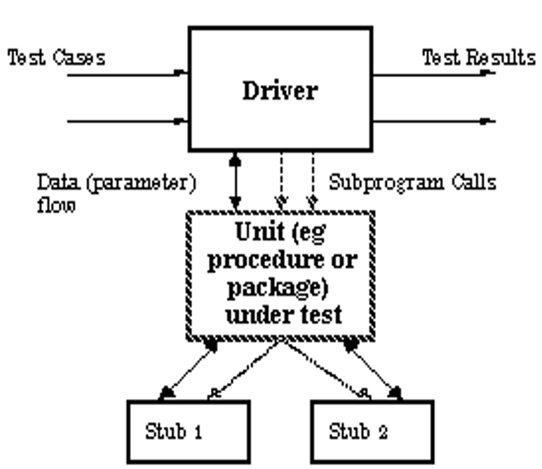

- 通过驱动程序和桩程序可以隔离被测单元，并使测试能够执行

#### 驱动模块 Driver

用以**模拟被测模块的上层调用者**，负责组装测试数据、调用被测函数并输出测试结果

#### 桩模块 Stub

用以**模拟被测模块在执行过程中调用的下层被依赖模块**，用于解耦复杂依赖

> 为了避免单纯硬编码返回固定单一数值（如 `return 10.00;`），应构建 **参数化桩（Parameterized Stub）** 以应对不同测试用例的分支覆盖需求

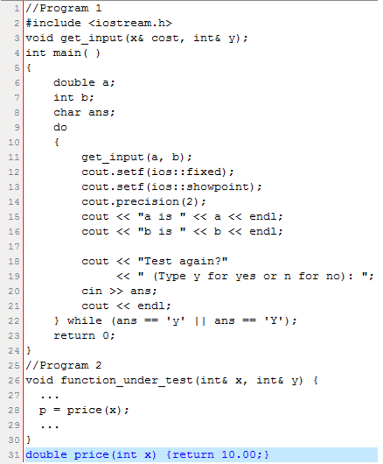

### 分层单元测试（了解）

应用程序分层构造，单元测试的时候也需要分层进行，可以分为：

- Action 层的单元测试
- 数据访问层的单元测试
- Servlet 的单元测试

### 单元测试工具套件（了解）

- 单元测试工具：JUnit：一个开放源代码的 Java 测试框架，目前已经成为 Java 单元测试框架的业界标准
- Mock 框架：Mockito：一个支持 Java 的 Mock 框架
- 覆盖率工具：JaCoCo：开源的 Java 测试覆盖率统计工具，基于 Java 二进制代码，而无需源文件

### 测试中模拟部件行为的技术：

- Stub：占位，为待测试对象提供接口，往往返回固定的值
- Mock：比 Stub 复杂，可以模拟更复杂的功能（内有断言，可以对执行的正确性进行判断）
- Fake：模拟性更强，类似于待测试系统的一个简化实现，但不强调断言的存在

## 单体系统集成测试

### 集成测试的定位和作用

集成测试（integration test）将已经分别通过测试的单元按设计要求集成起来再执行测试，以检查这些单元之间的接口是否存在问题

### 单体架构集成测试的两类模式

#### 渐增式测试模式

把下一个要测试的模块同已经测试好的模块结合起来进行测试，测试完以后再把下一个应该测试的模块结合进来测试。包括自顶向下，自底向上等

#### 非渐增式测试模式

先分别测试每个模块，再把所有模块按设计要求放在一起结合成所要的程序，如大棒模式

### 常见的单体架构集成测试方法

#### 大棒集成方法

先对每一个子模块进行测试（单元测试阶段），然后将所有模块一次性地全部集成起来进行集成测试

- 由于所有的模块一次集成的，所以很难确定出错的真正位置、所在的模块、错误的原因
- 这种方法通常不作为首选，但系统规模较小、模块依赖简单时可以考虑使用。

#### 自顶向下法

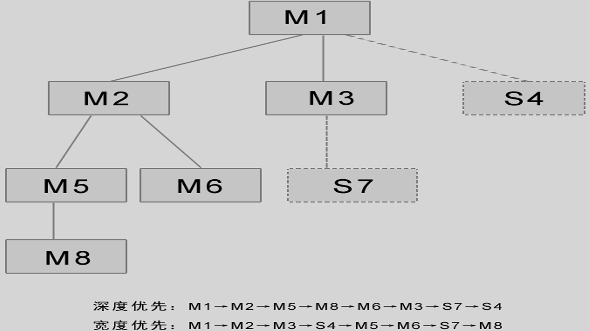

- 核心思想：从主控模块开始，沿软件的控制结构向下移动，从而把各个模块结合起来
- 主要步骤：
  - 先对主控模块进行测试，此时用桩代替所有附属于主控模块的模块
  - 根据结合策略，每次用一个实际模块代替一个桩。如果这个模块还依赖未集成的下层模块，就给这些依赖补上相应的桩。
  - 在加入新单元的同时进行测试。如果有需要进行回归测试
  - 重复以上步骤直到所有单元都加入完毕
- 优点：能够较早地找到上层单元（往往较为重要）的问题
- 缺点：需要维护大量的桩；底层的单元被测试的时间过晚

#### 自底向上法

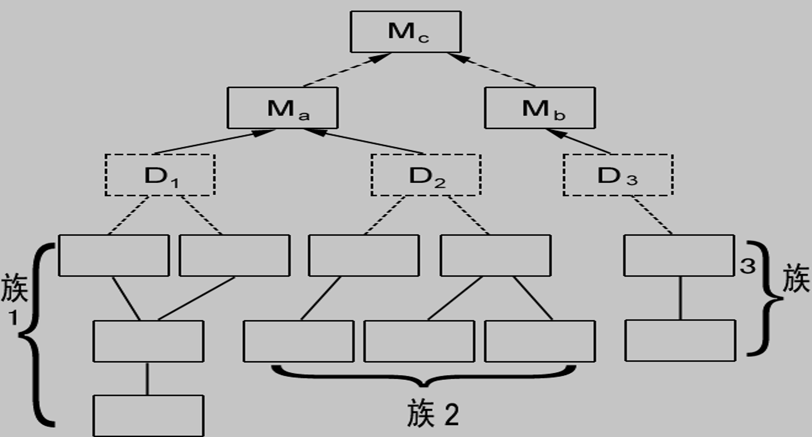

- 核心思想：从最底层模块开始，逐渐上垒
- 主要步骤：
  - 从底层单元开始，可以把多个底层单元合并在一起测试。需要写驱动程序。进行测试
  - 去掉驱动程序，沿软件结构从下到上移动，把子功能族组合成更大的子功能族，写驱动并测试，直至所有单元的测试完成
- 优缺点：与自顶向下方法反过来

#### 混合策略——如三明治式集成

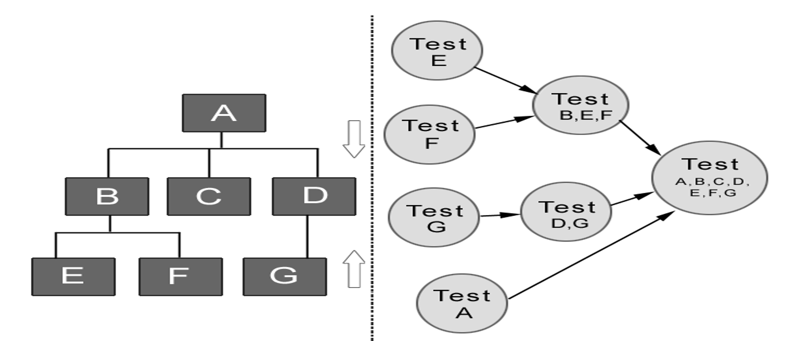

- 核心思想：结合自顶向下和自底向上方法：对软件结构中较上层，使用的是“自顶向下”法；对软件结构中较下层，使用的是“自底向上”法，两者相结合
- 三明治式集成的主要步骤：
  - 先确定以哪一层为界进行集成
  - 对选择的界限之上的层采用自顶向下策略进行集成，直到到达界限层为止
  - 对选择的界限之下的层采用自底向上策略进行集成，直到到达界限层为止
- 三明治式集成的优缺点：
  - 优点：把自顶向下和自底向上的集成结合起来。底层先行集成有助于减少需要编写的桩；上层如果还依赖未集成的模块，仍可用桩来替代。
  - 缺点：在真正集成之前每一个独立的模块没有完全测试过

#### 改进的三明治方法：

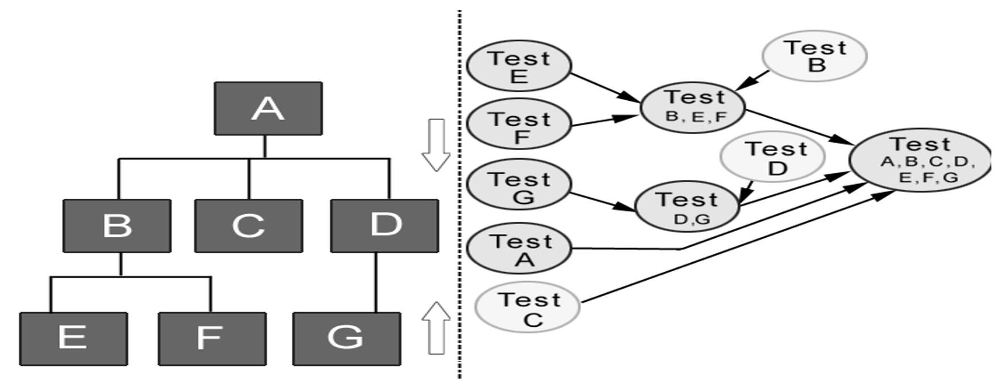

- 核心思想：不仅自两头向中间集成，而且保证每个模块得到单独的测试，使测试进行得比较彻底

## 微服务架构系统集成测试

> 分布式微服务架构下，服务间通过网络（REST/RPC）进行解耦，传统将所有服务部署在一起联调的“重量级集成测试”会导致环境极其脆弱、维护成本剧增。**消费者驱动的契约测试（CDC Testing）** 为分布式接口解耦提供了高效的解决方案

### 消费者驱动的契约测试（CDC Testing）

#### 契约 Contract 的定义

服务消费者（Consumer）与服务提供者（Provider）之间关于交互协议的正式约定，包含 Request 参数规范与 Response 返回数据结构

> **其理念是将服务消费者和提供者之间的互动正式化**

#### 消费者驱动原则：

由**消费端业务诉求出发**设计测试用例，明确定义“自己需要哪些字段”，并生成一份机器可读的**契约文件（Pact JSON）**，用于验证服务提供端功能

### 契约测试双向执行流程

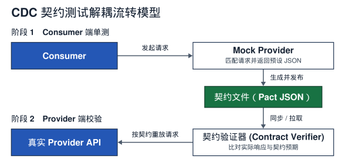

#### Consumer 端测试

Consumer 端针对本地生成的 Mock Provider 执行**单元测试**

测试通过后，框架生成包含请求与期望响应的契约文件，上传至契约仓库

#### Provider 端测试

Provider 端拉取契约文件执行**接口测试**

由契约校验器向 Provider 的真实 API 发送契约中的请求，校验其响应是否符合契约文件的定义

### CI/CD 与持续测试

#### CI/CD 核心概念

- **持续集成（Continuous Integration, CI）**：开发人员频繁将代码提交到主分支，由系统自动触发构建与自动化测试，确保新代码始终可编译、可运行、无冲突
- **持续交付（Continuous Delivery, CD）**：CI 的延伸，在代码通过流水线测试后，自动化打包并生成可随时部署到准生产/生产环境的发布版本
- **持续部署（Continuous Deployment, CD）**：持续交付的终极形态，所有通过全套自动化测试的代码自动部署上线到生产环境，对全流程自动化测试的稳定性要求极高

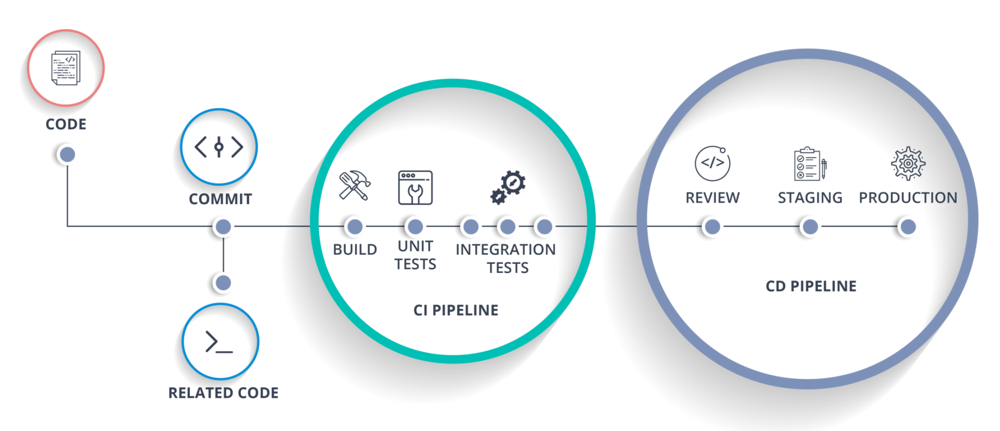

CI/CD 可以更早发现错误，提高生产率并缩短开发周期

#### 持续测试的定义

**持续测试（Continuous Testing, CT）** 是自动化测试无缝嵌入到软件交付流水线中，伴随代码构建、部署各个节点持续执行，以实时评估软件候选版本的业务风险

#### CI/CD 与持续测试的关系：

CD 倒逼持续测试：

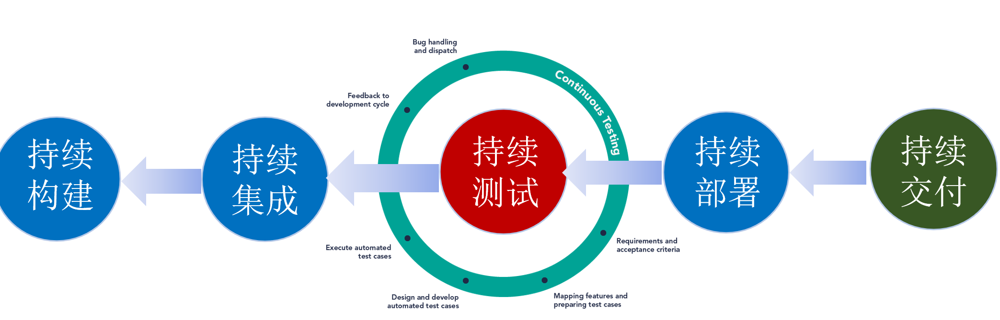

#### 持续系统落地的支撑体系（了解）

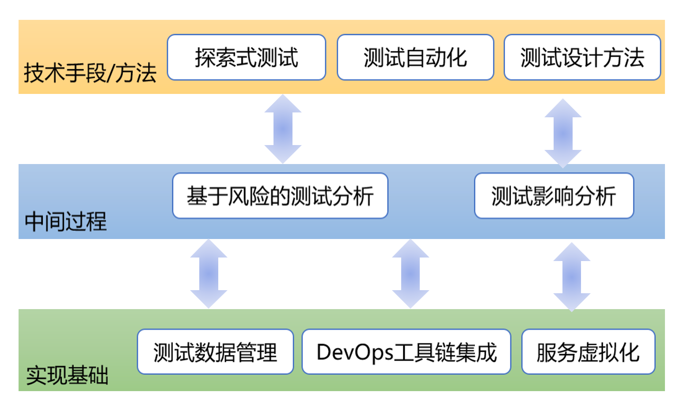

<!-- learning-journey:update-history:start -->
## 更新记录

| 日期 | 类型 | 说明 |
| --- | --- | --- |
| 2026-11-16 | 首次发布 | 从语雀整理并发布到学习记录仓库 |
<!-- learning-journey:update-history:end -->
