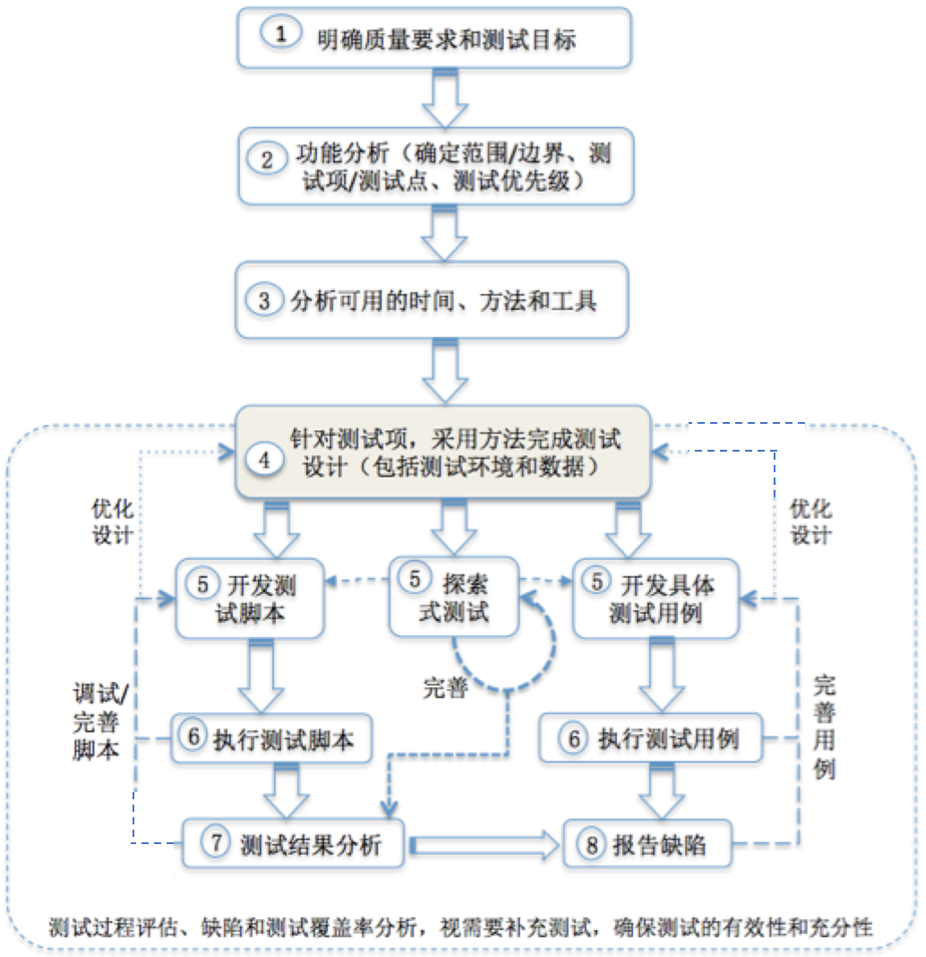
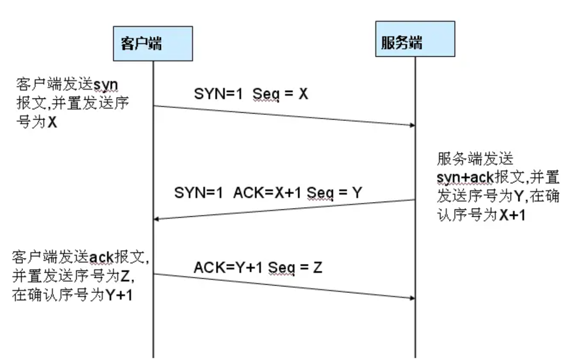
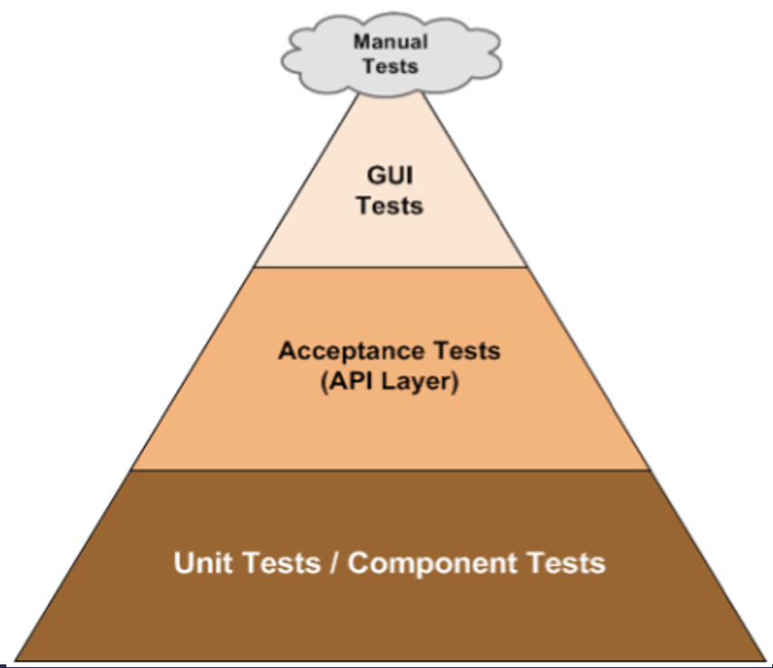

# 第六章：系统测试，回归测试，精准测试

## 系统测试概述

### 系统测试的定义

- 系统测试（system testing）是在完成集成测试之后，将待测软件与计算机硬件、输入输出设备、数据、网络、支撑软件及第三方软件等综合在一起，进行一系列测试，以验证系统在功能、性能等方面满足用户的预期和要求
- 系统测试的目的是验证整个系统与需求规格说明书一致
- 由于软件规模通常较为庞大，系统测试通常采用黑盒测试技术：等价类划分，边界值分析等

### 系统测试的分类

- 产品质量包括功能适应性，兼容性，性能，安全性，可靠性和易用性
- 对应的系统测试也分为功能测试，兼容性测试，性能测试，安全性测试，可靠性测试和易用性测试

## 系统功能测试

### 单元功能测试 v.s. 系统功能测试

- 单元测试中的功能测试，其目的是**保证所测试的独立模块的功能是正确的，主要从输入输出来判断是否满足设计要求**
- 系统测试中的功能测试，要考虑**模块间的相互作用和系统的应用环境，其衡量标准是规格说明书，需要模拟用户完成完整的业务**

### 系统功能测试的对象范畴

功能（Function）、界面（UI）、数据（Data）、逻辑（Logic）、接口（API）等

### 系统功能测试考虑的问题

1. 这项功能和哪些业务有关系
2. 这项功能在系统中起什么作用
3. 谁会使用这项功能
4. 用户如何使用这项功能
5. 这些功能的典型应用场景有哪些
6. 这个功能与哪些功能有关
7. 掌握这个功能的相关信息清楚充分吗，还缺什么信息

### 系统功能测试的基本思路

1. 明确质量要求和测试目标
2. 阅读需求文档，分析被测功能，列出测试项
3. 选择合适的测试方法和工具
4. 设计测试策略，设计测试用例
5. 准备测试数据，搭建测试环境，执行测试用例
6. 分析测试结果，评估测试的充分性
7. 提交测试报告

### 系统功能测试要点

- 每项功能符合实际要求
- 功能逻辑清晰，符合使用者习惯
- 系统界面清晰美观
- 菜单、按钮操作正常、灵活，能处理异常操作
- 接收正常输入，对异常输入容错处理
- 数据的输出结果准确，结构清晰，可保存读取
- 系统各种状态随业务流程改变，并保持稳定

### 面向接口的功能测试

> 系统级测试中，除了前端交互，大量功能逻辑直接沉淀在接口层，常见的接口类型包含 HTTP 接口、Web Service 接口和 RESTful 接口

#### HTTP 协议接口

- **交互过程**：通过 TCP 三次握手建立连接，客户端模拟请求发送，服务端接收并响应
- **请求报文结构**：**请求行**、**请求头部**、**空行**、**请求数据**
- **响应报文结构**：**状态行**、**响应头部**、**空行**、**响应正文**

#### Web Service 接口

Web Service 是一种以 Web 形式提供的分布式网络服务，依赖三大底层技术基石：

- **SOAP（Simple Object Access Protocol，简单对象访问协议）**：基于 XML 进行信息交换的通信协议。往往通过 HTTP 进行消息传递
- **WSDL（Web Services Description Language，网络服务描述语言）**：基于 XML 的语言，用以描述网络服务，以及其函数、参数和返回值等访问所需的信息
- **UDDI（Universal Description, Discovery, and Integration，统一描述、发现和集成）**：基于 XML 语言，用以描述、发表和寻找网络服务的机制。UDDI 利用 SOAP 消息机制来发布、编辑、浏览以及查找注册信息。采用 XML 格式来封装各种不同类型的数据

#### RESTful 接口

- **核心定义**：Representational State Transfer，一种基于 HTTP 的轻量级软件架构风格与设计原则
- **核心设计**：
  - 面向资源：对象实例均被抽象为**资源**
  - **URL 纯名词规范（无动词）**
  - 统一操作与无状态性（Stateless）

### 面向 UI 的功能测试

- 重点测试功能逻辑，按功能、子功能、功能点等层次展开测试
- 基于输入域和组合测试等方法进行输入的设计并测试，观察输出
- 扮演用户角色，从应用场景来遍历用户使用产品的主要操作路径，针对不同设置进行测试

## 功能测试自动化

### 测试自动化金字塔分层模型

- **底层：单元测试/组件测试**：针对函数、类进行测试；更容易实现自动化，投资回报率最高，常用工具：JUnit
- **中层：验收/API 接口测试**：在集成测试或系统测试阶段执行，验证模块间交互行为；自动化用例编写和维护要求高，常用工具：Postman
- **顶层：UI 测试**：测试用户界面，真实还原用户操作；自动化需要特定的工具和技术，常用工具：Selenium
- **塔尖：手工测试**

### 基于接口的自动化测试——Postman API

- **Postman 定位**：支持 API 全生命周期管理，易用性极高，广泛用于 REST 与 SOAP 测试
- **API 生命周期管理阶段**：包含 Define（定义）、Design & Mock（设计与打桩）、Develop（开发）、Automated Testing（自动化测试）、Secure（安全）、Deploy（部署）、Monitor（监控）、Document（文档）等
- **Collection（集合）机制**：在 Postman 中创建 Collection 保存测试请求，**每个 Collection 相当于一个测试用例集**

### Web 客户端的 UI 自动化测试

#### 基于 Selenium 测试框架

- 核心概念：开源且应用极广的 Web 自动化测试框架，支持跨平台（Windows/Linux/macOS）和多种主流编程语言（Java、Python 等）
- 工作机制（HTTP 中转控制）：测试代码并不直接跑在浏览器里，而是通过网络（HTTP / JSON Wire Protocol）把操作指令发给各浏览器的独立驱动（如 ChromeDriver），再由驱动在外部操控真实浏览器执行点击、输入和断言
- 核心组成：
  - Selenium WebDriver：核心组件，提供统一的跨浏览器编程接口与指令分发
  - Selenium IDE：免编程的浏览器插件，用于录制与回放测试操作
  - Selenium Grid：用于将测试分发到多台远程机器与浏览器上并行执行

#### 基于 Cypress 测试框架

- 核心概念：基于 JavaScript 的新一代前端测试工具，专为现代 Web 框架（如 Vue、React）设计，覆盖单元、集成到端到端（E2E）全金字塔测试
- 核心特性与机制（浏览器内原生运行）：
  - All-in-one（自集成）：自带测试运行器、断言库和 Mock/Stub 工具，无需像 Selenium 那样拼装各种外部库，开箱即用
  - 同一进程运行：测试代码和被测 Web 应用直接运行在同一个由 Cypress 控制的浏览器内部，因此能同步、直接地访问 DOM 元素、Window 对象和本地存储，没有跨网络通信的延迟与脆弱感
  - 时光穿梭（Time-travel）：支持对测试运行的每一步操作状态进行回看与调试

### 安卓应用的 UI 自动化测试

#### 基于 Instrumentation 框架

- 代表工具：Robotium、Espresso、Selendroid
- 工作机制（同进程 / 内部注入）：
  - 框架通过数字签名机制，让安卓系统认为测试 App 和被测 App 属于同一个进程
  - 测试程序与被测程序在同一个 Linux 进程里作为两个不同的线程协同运行
- 特点与能力：因为在同一进程内，测试程序权限极高，可以直接操作 Activity 生命周期函数、在启动前注入 Mock 模拟对象，并深入检查应用内部的私有内存状态；但通常无法跨应用测试

#### 基于 UIAutomator 框架

- 代表工具：UiAutomator、Appium（Appium 底层在安卓端也是基于 UIAutomator 封装的）
- 工作机制（跨进程 / 外部事件模拟）：
  - 测试进程与目标应用进程是彻底分开隔离的
  - 测试框架拿不到目标应用内部的类或内存属性，只能像真实用户一样，通过向操作系统发出全局的点击、滑动、按键等输入事件来间接操控应用
- 特点与能力：天生支持跨应用测试（比如从当前 App 跳到微信或系统设置页）；支持设备无源码（黑盒）测试

## 回归测试

### 回归缺陷的定义

原来正常工作的功能，并没有发生任何需求改变，仅仅由于受到其他模块改动的影响而产生的次生缺陷

### 回归测试的定义

回归测试在已经开发并测试过的软件发生改变之后进行，对这些软件再次进行功能或非功能的测试，以保证程序的行为与预期相符

回归测试就是为了发现回归缺陷而进行的测试

### 代码改变的四大触发源

修改 Bug、软件功能增强、配置改变、重要底层部件更换

### 回归测试四大方法

每次修改后重新执行全量测试在工程成本上是不可行的，必须根据风险裁剪用例，常用策略包括

1. **再测试所有测试用例（Retest All）**：将既有用例全部重新执行一遍；最安全彻底，但耗时极长，仅适用于关键版本发布
2. **基于风险选择测试用例（Risk-based Selection）**：优先选择那些可能带来高严重度质量风险的核心业务与高频用例
3. **基于操作剖面选择测试用例（Operational Profile-based）**：根据用户真实使用统计概率，优先覆盖用户最常用的高频操作路径
4. **再测试修改的部分（Retest Changes Only）**：仅测试被修改的代码功能及其紧密耦合的关联模块

## 精准测试

### 精准测试定义

建立“软件功能”与“软件代码”之间的强关联，建立“代码语句”与“测试用例”之间的双向映射关系

用于解决传统回归测试“全量跑跑不动，抽样跑心里慌”的问题

### 精准测试实施流程

1. 代码变更
2. 代码差异比对——>精准识别出变更的方法/行
3. 影响范围依赖分析：基于调用图 (Call Graph) 分析间接受影响的模块
4. 代码-用例映射库匹配：自动推荐命中影响代码的最小测试用例子集，实现极速精准回归

### 精准测试的技术价值

将回归测试的用例选择从“凭经验猜”升级为“通过代码调用关系进行精准数学推导”，在保证质量覆盖的同时将测试执行开销降至最低

<!-- learning-journey:update-history:start -->
## 更新记录

| 日期 | 类型 | 说明 |
| --- | --- | --- |
| 2026-11-16 | 首次发布 | 从语雀整理并发布到学习记录仓库 |
<!-- learning-journey:update-history:end -->
