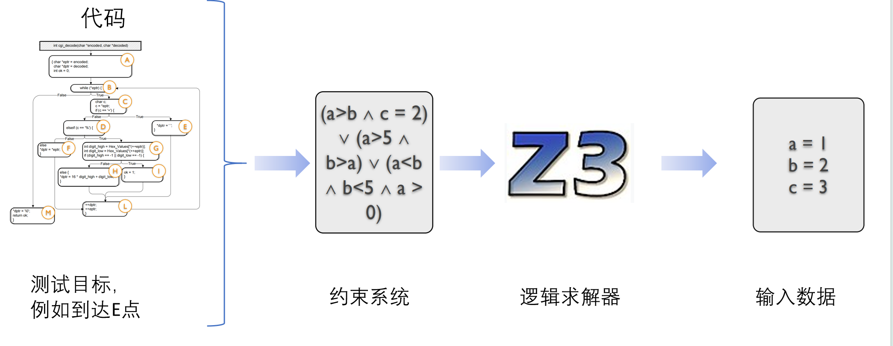
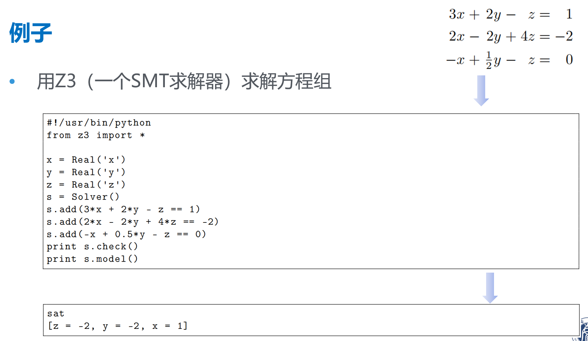
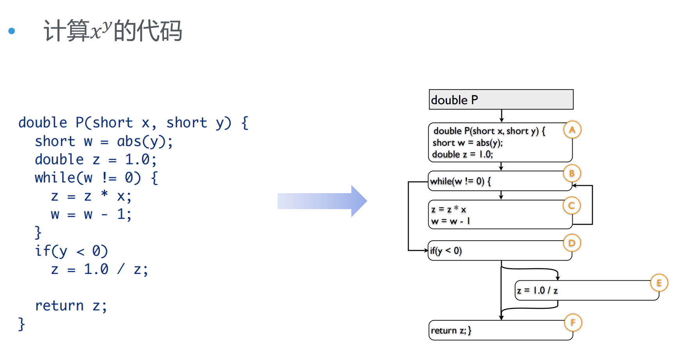
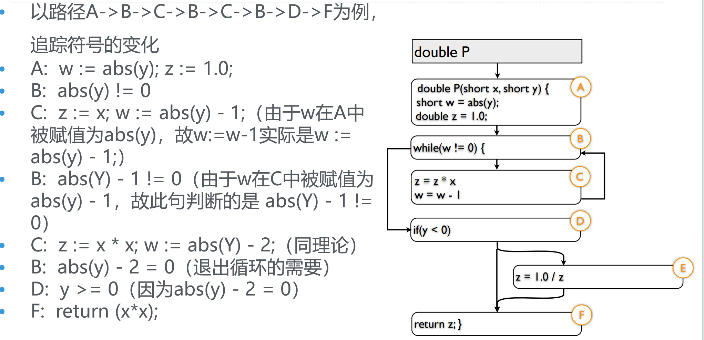
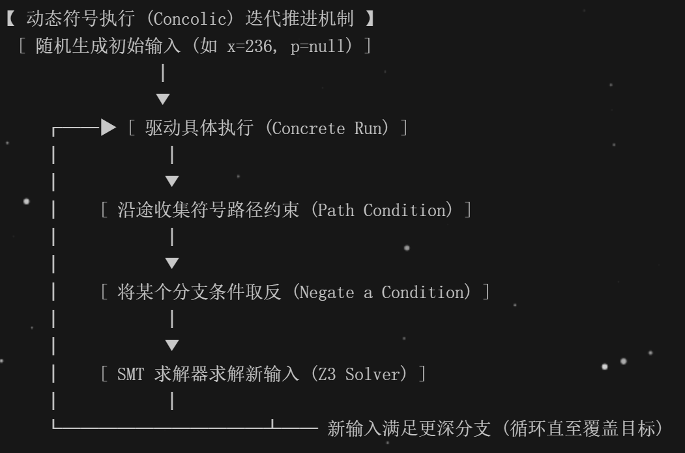

# 第四章第三节：变异测试与符号执行（了解？）

## 变异测试

### 变异测试的动机

好的测试用例应当能够“充分”地暴露错误

变异测试提供了一种评估测试用例集有效性的度量手段

### 变异测试的定义

变异测试基于已有代码，向代码中注入微小故障，形成变异体；通过度量已有测试用例捕捉这些错误的能力来度量已有测试用例的充分性、有效性

+ 如果注入的错误被某个测试用例捕捉到，则这个测试用例是有效的
+ 如果注入的错误没有被任何测试用例捕捉到，则说明测试用例不够有效

### 变异测试的两大理论假设：

1. 熟练程序员假设：假定程序员编写的代码已经与正确代码非常接近，那么绝大多数软件错误不是整体逻辑的胡写乱造，而只需对源代码做很小的局部修改就可以纠正
2. 耦合效应：复杂的程序缺陷往往可以视为若干简单缺陷的复合组合；如果测试用例能够检测出简单的局部缺陷，那么它们通常也能大概率发现更为复杂的复合缺陷

### 变异测试相关概念

+ 变异算子：变异测试通过替换操作符等对代码进行改写的方式
+ 变体：由 P 经过变异算子得到的 Q，称为变体
+ 被击杀（killed）：如果存在某个测试用例，使得 P 和 Q 在此上面执行结果不同，则变体 Q 被击杀

### 变体被击杀的三大必要条件

1. **到达性（Reachability）**：测试执行路径必须经过被改变/修改后的变异语句
2. **感染性（Infection）**：经过变异语句后，变异程序必须与原程序进入不同的内部状态（例如内部变量值出现偏差）
3. **传播性（Propagation）**：内部状态的差异必须能够一路传递到程序的外部可见语句，并最终在输出中展示出来

强变异测试需要以上三条全满足；而弱变异测试只满足前两条即可，只要变异语句被执行，且立即导致内部变量状态产生差异，即认定变异体被杀死（无需等待该差异一路传播到最终输出）

### 变异测试的流程

1. 生成变体
2. 运行测试并计算杀死变体集合
3. 计算等价变体集合
4. 代入公式计算变异评分

#### 等价变体

有些变体可能与源代码是等价的，即没有测试用例能够区分

判定变体是否等价在理论上是不可判定的，通常需要人工审查识别

#### 变异评分

$$
\text{变异评分 (Mutation Score)} = \frac{\operatorname{killed}(M, T)}{|T| - \operatorname{equiv}(T)}
$$

+ $`|T|`$：生成的变体总数
+ $`\operatorname{killed}(M, T)`$：被测试用例杀死的变体数量
+ $`\operatorname{equiv}(T)`$：变体集合中等价变体的数量

### 变异算子体系

+ 变异算子的目标：模拟程序员在开发中可能出现的经典、典型的小错误

以面向对象语言 Java 45 个标准变异算子为例，包括：

+ 16 个方法级传统变异算子（运算符替换、语句、变量删除等）
+ 29 个面向对象类级变异算子：封装变异、继承变异、多态与类型变异、Java 语言特性变异等

### 变异测试的缺陷

+ 缺点：变体数量极其庞大，每条语句都有变异的可能，变异后程序需要重新编译执行；且测试用例可能庞大
+ 可通过：
    - **减少变体数量**：变体采样、选择性变异
    - **智能剪枝与优化流程**：弱变异、并行化执行等
    - **编译与底层执行硬件加速**：直接修改字节码等

## 基于约束的测试（Constraint-Based Testing, CBT）

### CBT 定义：

CBT 旨在利用数学命题与逻辑约束，全自动生成测试用例

### CBT 基本步骤：

1. 约束生成：根据控制流分支、待测目标点或变异体条件，将程序路径条件转化为数学逻辑公式（约束系统）
2. 约束求解：将公式输入逻辑求解器（Constraint Solver），求解出一组能让公式成立的具体解
3. 测试用例生成：将求解器给出的变量数值实例化为具体的测试输入数据

### 约束

#### 定义

一个约束即是一个逻辑公式：`year%4==0 && year%400 !=0`

我们关注约束的可满足性问题：寻找到一个赋值，使得约束在这个赋值下为真

#### 约束系统

一个约束系统 S 包含：

+ 有穷变量集合 V
+ 有穷取值域集合 D
+ 有穷大小的约束集合 C

约束系统 S 的一个解是对 V 中变量的一个赋值，使得 C 中约束都得到满足

#### SMT 求解器

+ 传统的 SAT 求解器只能处理单纯的布尔逻辑，但现实程序代码存在大量复杂运算，纯布尔 SAT 无法解决算术逻辑方程
+ SMT = SAT + 各种数学理论
+ 作用：SMT 在布尔逻辑的基础上，内嵌了专门处理各种现实数据结构的数学理论引擎（整数实数、位运算、数组链表等）；把程序代码里的各种分支条件扔给它，就能自动算出一组能让这些条件同时满足的测试输入数据

### 面向路径的测试与静态符号执行（了解）

#### 步骤：

1. 在控制流图/DD 路径图上选择路径
2. 生成路径上的条件：符号求值
3. 求解这个条件，生成合法输入数据，进而生成测试用例

#### 符号执行

定义：是一种抽象执行程序的技术，不运行真实代码，而是把输入视为符号（如 $`\alpha, \beta`$），沿着选定的路径追踪变量公式和路径约束，将程序执行的中间结果表示为关于这些符号的符号表达式

#### 符号状态三元组：

（路径，状态，路径条件）——>（p，s，c）

+ p 是控制流图/DD 路径图中一条路径
+ s 是二元组 (x, f) 的集合，x 为一个变量，f 为 x 对应的值且以公式形式表示
+ c 为一个逻辑公式

### 动态符号执行

#### 定义

组合了符号执行与具体执行

#### 步骤

1. 随机生成一个输入并执行对应路径
2. 生成对应的约束，将最后一个条件处取反
3. 判断新的约束是否可满足，如果可以的话生成新的测试用例

#### 核心思想总结

从 **随机初始具体输入** 出发驱动程序实际运行，沿途监控并收集实际走过的分支路径条件，随后通过 **取反叶子节点分支条件**，构造新的约束求解下一组输入，一步步迭代探索所有未知分支

<!-- learning-journey:update-history:start -->
## 更新记录

| 日期 | 类型 | 说明 |
| --- | --- | --- |
| 2026-11-16 | 首次发布 | 从语雀整理并发布到学习记录仓库 |
<!-- learning-journey:update-history:end -->
