# 读论文【1】Attention Is All You Need

> 论文原文：[Attention Is All You Need](https://arxiv.org/abs/1706.03762)
>
> 相关笔记：[Transformer 架构](../人工智能/大语言模型/2025-10-27-Transformer架构.md)

## 背景：

> 了解：FNN ：前馈神经网络
>
> 一种最基础的神经网络结构
>
> 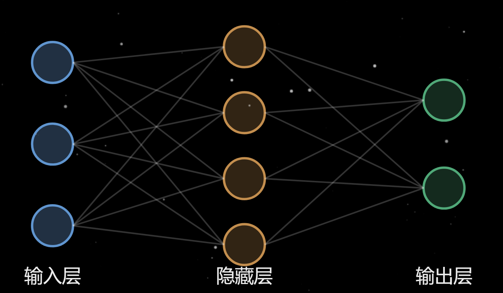
>
> 工作方式为，在输入层中输入一个**固定长度**的向量，经过几层计算得到一个新向量
>
> FNN 主要学习输入特征之间的映射，但由于其只能输入固定长度向量的局限，在做序列转换任务时需要将句子编码成固定长度输入向量，不利于 1.学习句子各词的位置关系 2.句子长度不固定，因此：（继续下面）
>

此前的 **序列转换任务（Sequence Transduction，如文本翻译、文本预测等）** 主要依靠 RNN （循环神经网络）或 CNN （卷积神经网络）构建的 Encoder–Decoder 模型

> RNN：通过循环计算，逐个理解序列，并参考之前序列信息的隐藏状态（缺点：固有的顺序性阻碍了训练样本内的并行化）
>
> 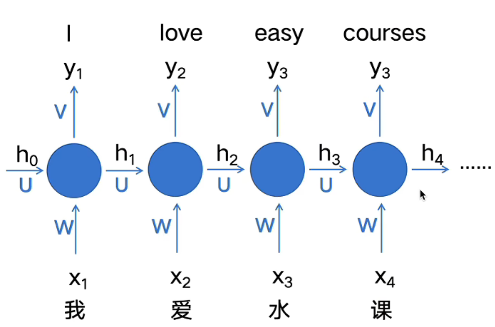
>
> 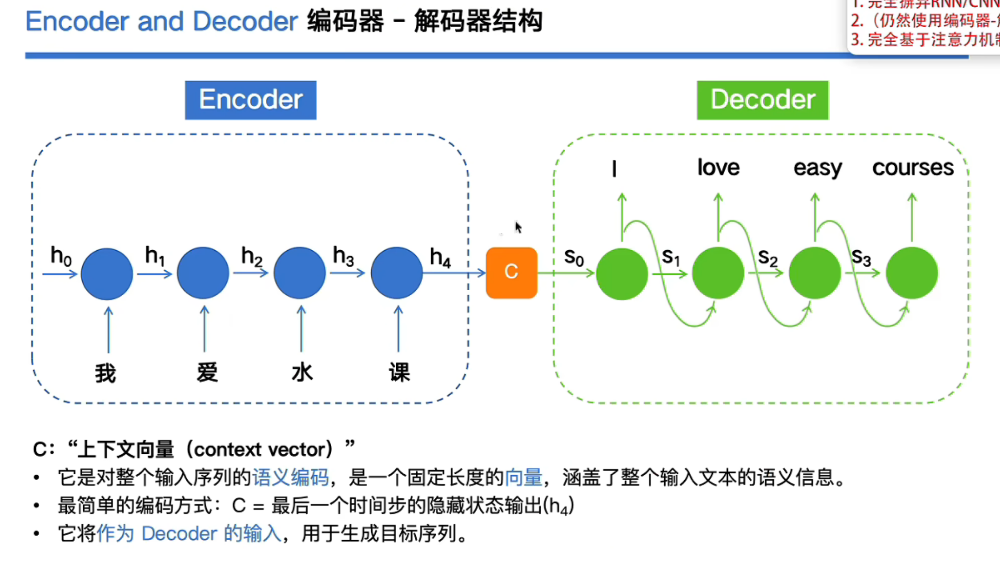
>
> CNN：通过一个可学习的卷积核参数（类似于滑动窗口），对不同位置区域内的数字向量进行计算（类似于在图片/序列上滑动），从局部区域提取特征；不同位置的卷积计算可以并行；然后再通过网络层整合（经过越多层的卷积层，位置能获取的信息范围越来越大）（缺点：学习远距离位置之间的依赖关系变得更加困难）
>

此前的一些模型中，已经尝试使用**注意力机制**连接 CNN 和 RNN 的 Decoder 和 Encoder； 即在生成不同输出词时，对输入序列中不同位置分配不同的注意力权重；

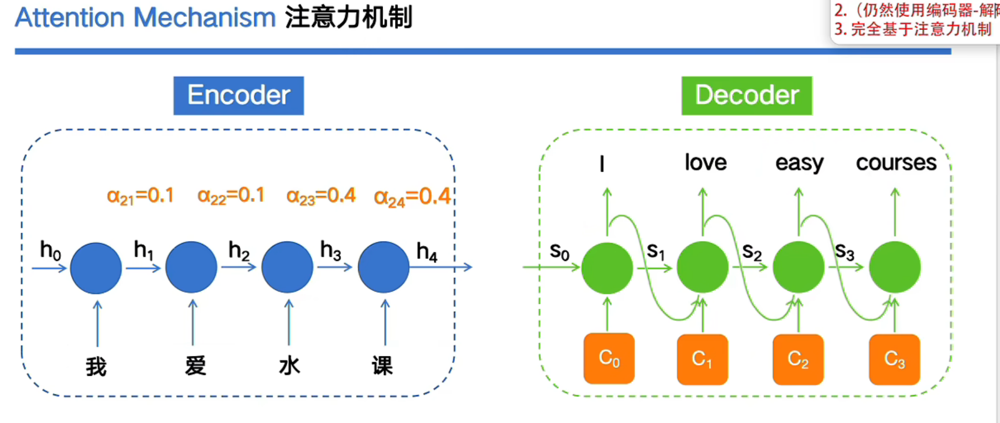

> [!NOTE]
> Transformer 之前的主流序列转换模型结构：
>
> + 基于 RNN / CNN
> + 使用 Encoder-Decoder 结构
> + 已经开始使用注意力机制来增强
>
> Transformer 之后的创新：
>
> + 完全摒弃 RNN / CNN
> + 仍然使用Encoder-Decoder 结构
> + 完全基于注意力机制来构建

## 本论文解决的两个重要问题

1. 如何提高并行计算能力
2. 如何更容易地建立远距离词语之间的联系

## Transformer 模型架构

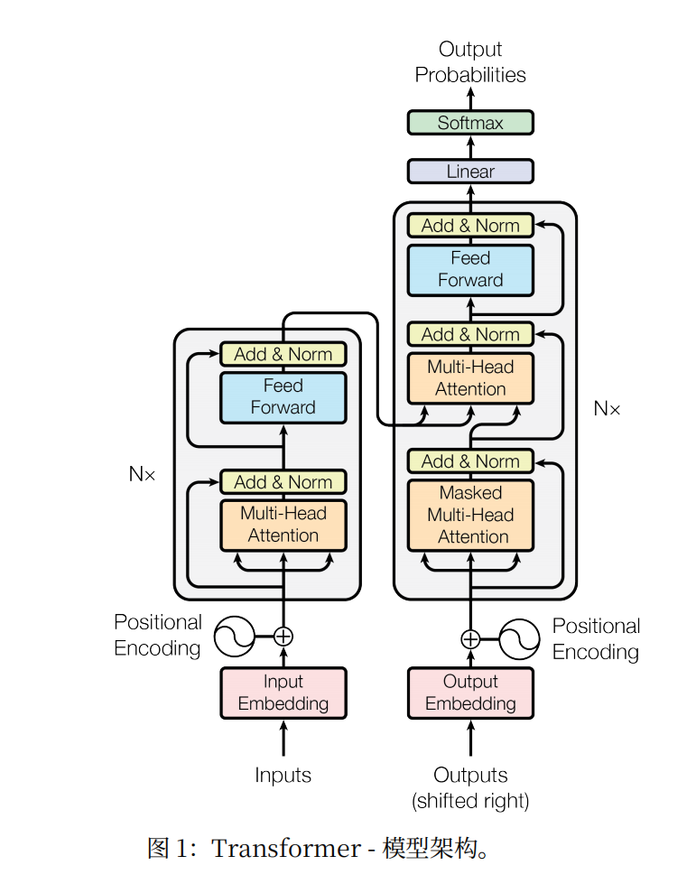

### 词嵌入 Input Embedding & Output Embedding——得到语义信息

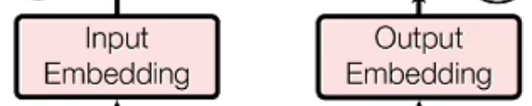

将输入的自然语言文本句子分词后，把每一个 Token 转化成机器能够理解的向量，Transformer 架构中为 512 维的向量（**权衡表达的信息含量和存储与计算成本**）；随后便可以通过词向量在向量空间中的位置关系去计算不同词语之间的相似关系

+ 词嵌入可以直接使用已经训练好的词嵌入模型，但是在 LLM 中大部分都是词嵌入模型和整个模型一起训练，优化参数，效果更优

> 为什么选 512 维？
>
> 主要原因就是**权衡表达的信息含量和存储与计算成本**
>
> 且原文进行过维度的比较训练，256——>512 提升明显，但 512——>1024 计算成本激增但是提升不明显
>
> 另外，**512 是 $`2^9`$，属于计算机中常用的 2 的整数次幂，同时它很方便进行多头注意力的维度划分（Transformer 有 8 个注意力头）**
>
> 且 GPU 的矩阵运算更适合一些特定整数倍的维度
>

### 位置编码 Positional Encoding——得到位置信息

由于 Transformer 没有 CNN、RNN；因此为了让模型能够得到序列之间的位置关系，需要进行位置编码：

位置编码就是将每一个 Token 都也生成一个 512 维（与嵌入词向量同维度）的位置向量；然后将位置向量与词嵌入向量相加 **【语义信息+位置信息】**

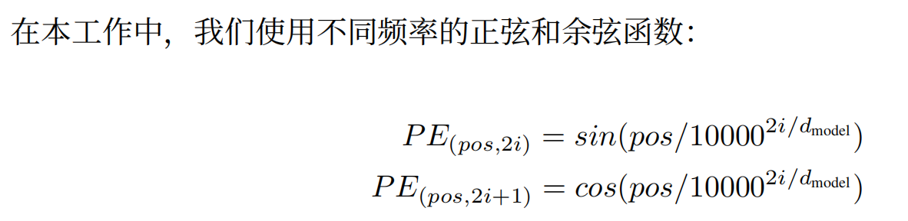

> 为什么选这个函数？
>
> + $`i`$: 选择第 i 组正弦、余弦函数
> + $`pos`$: 当前词在句子中的位置
> + $`d_{model}`$：向量的总维度
>
> 这个函数的实际意义：就是按照一定的规则，把 sin 和 cos 的计算结果放进位置编码向量的不同位置，如下：
>
> 假设位置编码向量只有 4 维：
>
> 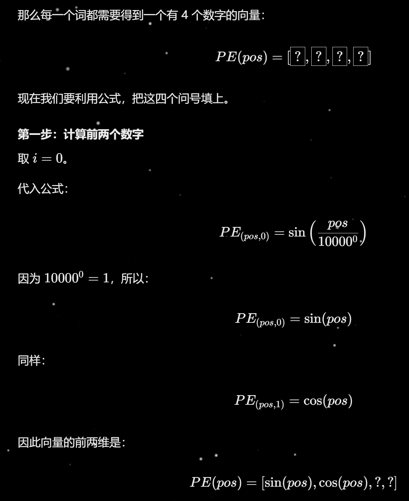 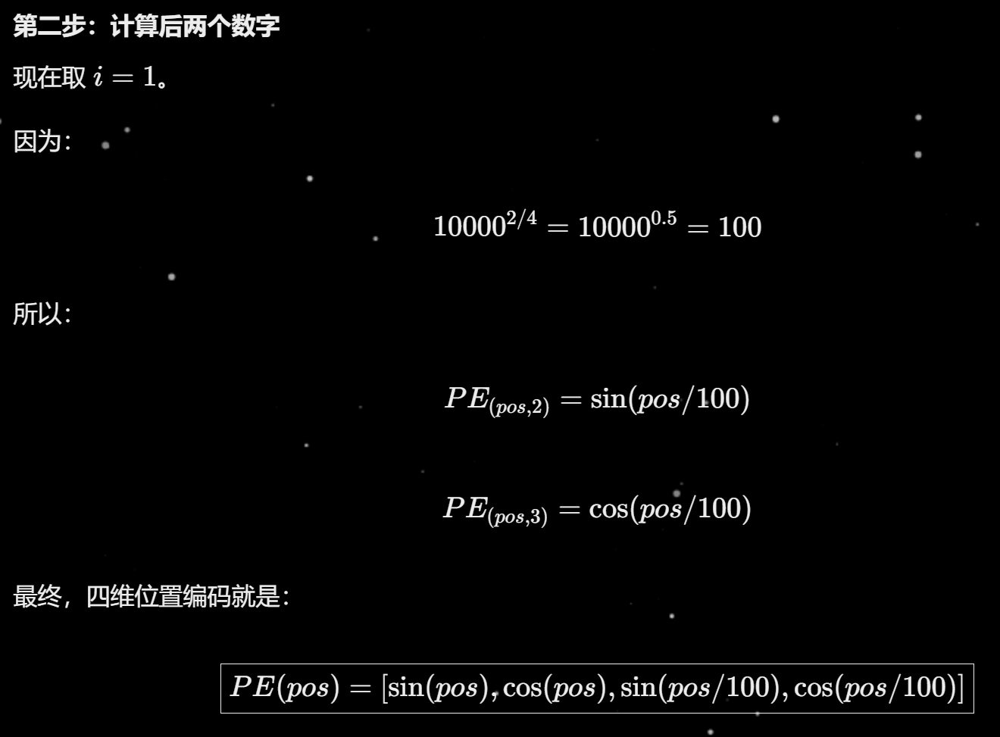
>
> $`10000^{2i/d_{\text{model}}}`$的作用：控制每一组 sin、cos 的变化速度（类似于用不同速度的钟表组合来表示位置，比只用一个周期性变化的钟表表示位置更容易区分）
>
> **关键在于：位置编码不仅要让模型知道“我在第几个位置”，最好还能让模型容易学习“我和其他位置有什么关系”**
>
> **sin 和 cos 的一个优势：它们通过特殊的数学结构，使模型更容易利用相对位置关系。  而 Transformer 的 Attention 机制也恰好使用点积**
>
> 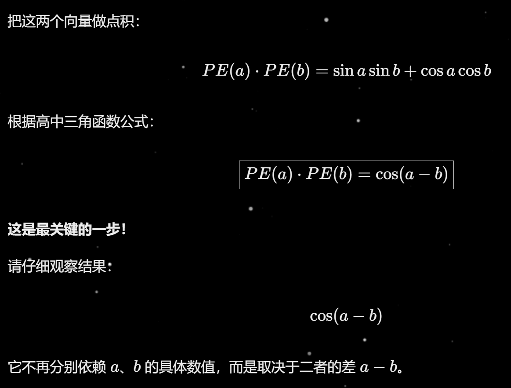
>
> **两个向量做点积，结果不再依赖其值，而是依赖二者的差值**
>
> **核心：Transformer 的注意力机制主要通过向量之间的点积计算关联，而不是先自动把两个位置编号相减**
>

### 自注意力机制——得到 Token 在整个输入中的上下文信息

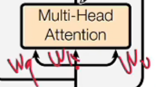

自注意力的“自”的意思就是注意力发生在同个输入序列的内部（自己和所在序列中的其他全部 Token）

整个过程：

1. 一个初始的包含了语义信息和位置信息的输入矩阵（$`\text{Token数}\  N \times 512`$）
2. 分别与提前训练好的**8 套**核心参数矩阵 $`W_q`$、$`W_k`$、$`W_v`$（都是 $`512 \times 64`$的矩阵）做矩阵乘法，得到**8 套**三个分别代表 Q、K、V 的$`\text{Token数}\  N \times 64`$矩阵
3. 8 套三个矩阵再进行多头注意力机制，最终得到 8 个包含语义信息、位置信息、上下文信息的矩阵（$`\text{Token数}\  N \times 64`$）
4. 最终拼接 8 个矩阵，得到与原输入矩阵维度相同的矩阵
5. 然后再经过一个线性层，得到最终的输入矩阵（$`\text{Token数}\  N \times 512`$）

#### 一个 单头注意力/缩放点积注意力 机制的计算过程

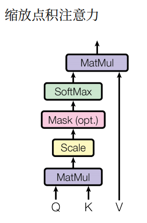

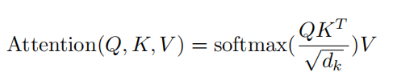

+ Q：查询向量 ：该 Token 需要寻找什么信息
+ K：键向量 ：该 Token 拥有什么信息（Q 查的时候相对于 Q 来说就是是否能匹配上的信息参考）
+ V：值向量：如果该 Token 被匹配上，可以提供什么实际信息

Attention 做的就是：对于一个 Token，用它的 Q 去匹配其他所有 Token 的 K，得到注意力权重，再用权重汇总 V

1. **第一步**：**计算**$`QK^T`$，得到 Token 的 Q 向量和每个 Token（包括自己） 的 K 向量的点积（匹配分数）：
2. **第二步**：**匹配分数除以**$`\sqrt{d_k}`$：缩小匹配分数，便于后续 Softmax 后的分数不极端，导致后面训练分数变化不敏感，梯度小
3. **第三步：进行 Softmax ：** 把全部 Token 的匹配分数转换成总和为 1 的非负权重
4. **第四步：乘上 V 值向量：** 根据权重汇总 V 值向量
5. Softmax 后得到 $`N \times N`$ 的注意力权重矩阵；再乘以 V 后，单头注意力最终输出 $`N \times 64`$ 的矩阵。

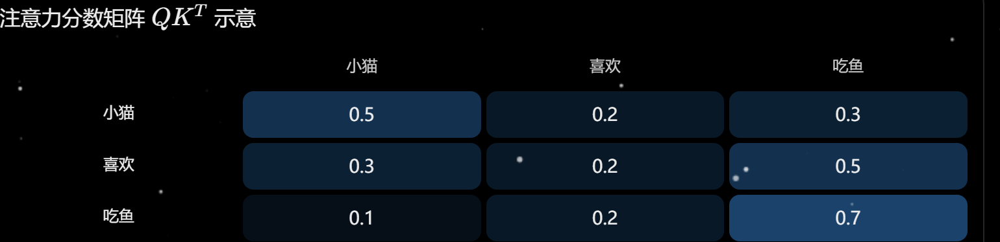

#### 多头注意力机制

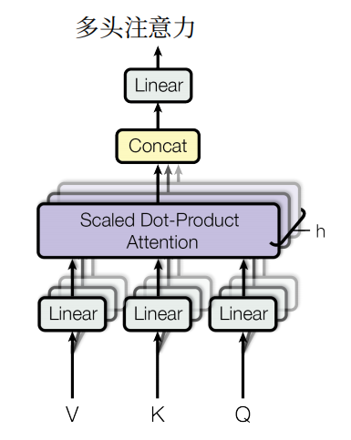

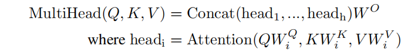

$$
\boxed{head_i=\operatorname{Attention}(QW_i^Q,KW_i^K,VW_i^V)}
$$

不同注意力头也就是提前训练好的一套核心参数矩阵 $`W_q`$、$`W_k`$、$`W_v`$不同，不同的头关注的重点信息不一样，因此参数也不同

因此在 Transformer 中，选择使用 8 个不同的注意力头，即每个注意力头都对原来的输入矩阵做了降维处理（$`\text{Token数}\  N \times 512`$——>$`\text{Token数}\  N \times 64`$）

**降维的本质就是：减少计算量同时保留数据的本身特征**

然后分别做自注意力机制后再进行 Concat 拼接回原来维度的矩阵

$$
\boxed{\operatorname{MultiHead}(Q,K,V)=\operatorname{Concat}(head_1,\ldots,head_h)W^O}
$$

#### 最终的线性层 Linear

Concat 后已经得到 $`N \times 512`$ 的矩阵；最终的线性层通过可学习的变换融合各个注意力头的信息，输出仍为 $`N \times 512`$。

#### 补充：解码器中的 掩码多头注意力机制层

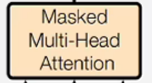

简单来说就是为了在训练时防作弊，通过把矩阵的某一部分来设置成负无穷（经过 Softmax 归一化会变成 0），来实现掩码

### Add & Norm 残差连接与层归一化

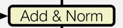

+ **Add 残差连接**：保留原来的信息，同时加入新学到的信息；深度学习中的一个经典操作：把经过一个模块的输出和原来的输入简单的相加在一起，一起作为输出给下一个模块；有利于将原始信息继续往下带，而不用关注某个模块没训练好的级联效应
+ **Norm 层归一化**：调整数据的数值分布，让数值具有更可控的尺度，让神经网络更容易稳定地训练；

### 前馈神经网络 FNN

除了注意力子层之外，我们的编码器和解码器中的每一层都包含一个全连接前馈网络

FNN 会对矩阵中的每个向量**分别**、**相同**地进行计算

$$
\boxed{\operatorname{FFN}(x)=\operatorname{ReLU}(xW_1+b_1)W_2+b_2=\max(0,xW_1+b_1)W_2+b_2}
$$

过程：先进行线性变换（升维，把输入映射到更高维的特征空间；512——>2048）；然后进行激活函数（引入非线性，使网络可以学习复杂关系）；最后再进行线性变换（降维，把特征重新组合为模型所需的维度）

### Encoder、Decoder 堆叠

#### 编码器：

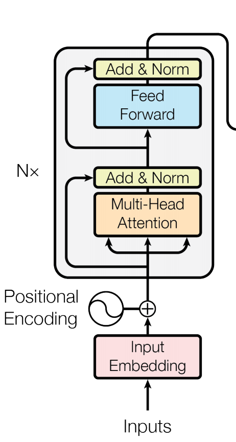

编码器由 N = 6 个相同层堆叠而成。每层包含两个子层：

1. 多头自注意力机制 + 残差连接与层归一化
2. 逐位置全连接前馈网络 + 残差连接与层归一化

每个子层的输出为 LayerNorm(x + Sublayer(x))

#### 解码器：

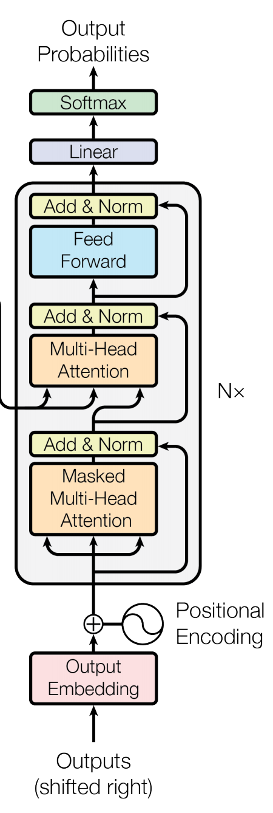

解码器由 N = 6 个相同层堆叠而成。除了编码器的两个子层外，还包括：

1. 对编码器堆叠的输出执行多头注意力
2. 将编码器中的多头注意力机制修改为掩码多头注意力机制，来防作弊；确保了对位置 i 的预测只能依赖于小于 i 的位置处的已知输出

## 自注意力机制的优点

1. 当序列长度 $`n`$ 小于表示维度 $`d`$ 时，自注意力层的计算复杂度低于循环层。
2. 获得了并行计算能力
3. 模型内部学习长距离关系的能力大大增强

<!-- learning-journey:update-history:start -->
## 更新记录

| 日期 | 类型 | 说明 |
| --- | --- | --- |
| 2026-11-14 | 首次发布 | 从语雀整理并发布到学习记录仓库 |
<!-- learning-journey:update-history:end -->
